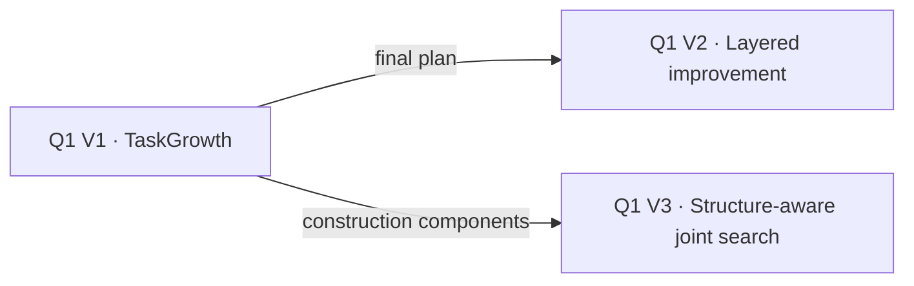
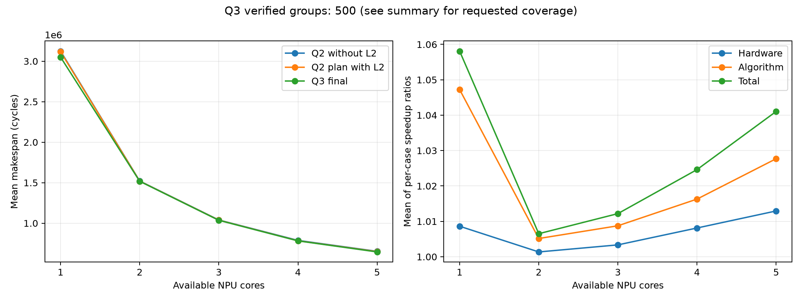

<h1 align="center">2026 Huawei Cup · Multicore NPU Scheduling</h1>
<p align="center"><strong>Multicore Scheduling and Memory Optimization for NPU Computation Graphs</strong></p>
<p align="center"><a href="README.md">简体中文</a> · <b>English</b></p>
<p align="center">
  <a href="https://github.com/Kk111777/HuaweiCup2026A"></a>
  
  
  
  
</p>
<p align="center">
  <a href="#overview">Overview</a> · <a href="#quick-start">Quick Start</a> ·
  <a href="#models">Models</a> · <a href="#results">Results</a> ·
  <a href="docs/README.md">Documentation</a> · <a href="docs/data.md">Problem &amp; Data</a>
</p>

This project studies **joint multicore scheduling and memory optimization for NPU computation graphs**. Given an operation–tensor DAG, it chooses subgraph partitions, core assignments, and execution order under dependency, on-chip capacity, and shared-bandwidth constraints, optimizing simulated cycles and data movement.

Efficient large-language-model execution depends on both computation and data supply. Operations in attention, linear projections, and feed-forward networks have dependencies, while their intermediate tensors occupy limited fast memory. Execution order changes tensor lifetimes and reuse opportunities; partitioning computation to expose parallelism can also introduce communication and spill traffic. **Where to compute, in what order, and which data to keep resident** are therefore coupled decisions.

This connects naturally to several areas of LLM systems research. **IO-aware operator optimization** considers computation together with data movement: [FlashAttention](https://arxiv.org/abs/2205.14135) uses tiling to reduce reads and writes between HBM and on-chip SRAM. **Memory hierarchy and offloading** address tensor placement and access under capacity constraints: [FlexGen](https://proceedings.mlr.press/v202/sheng23a.html) coordinates GPU, CPU, and disk resources for throughput-oriented LLM inference. **Graph compilation and automatic parallelization** map dependent computation onto execution resources: [Alpa](https://arxiv.org/abs/2201.12023) jointly plans intra-operator and inter-operator parallelism for distributed training of large models. Although these systems operate at different scales, they illustrate the need to consider graph structure, memory capacity, and communication cost together.

This repository develops that perspective as graph-theoretic and combinatorial optimization problems. Its three competition scenarios study **multiple-Task partitioning and scheduling, shared intra-core memory, and shared L2 reuse**, using heuristic construction, local search, dynamic programming, and official event simulation. The project originated from Huawei Cup Problem A, *Multicore Scheduling for General-Purpose Neural Network Processors*, and uses its 100 original graphs. Scheduling plans are evaluated by execution cycles and data movement reported by the official simulator.

The repository is owned by [Kk111777](https://github.com/Kk111777), with [Zysishuiyears](https://github.com/Zysishuiyears) as a collaborator. The team maintains code and experiments through task branches and pull requests; each experiment archive records the source revision and run settings.

### At a Glance

| Graph Scheduling · Q1 V3 | On-Chip Memory · Q2 v3 | L2 Reuse · Published Q3 |
|:---:|:---:|:---:|
| **4.297×** mean speedup | **4.185×** mean speedup | **500 / 500** official replays passed |
| 100 graphs · 5 cores · fixed single-core reference | 100 graphs · 5 cores · fixed single-core reference | 100 graphs · 1–5 cores · frozen Q2 reference |

[Full versioned results, budgets, and provenance](#results)

<a id="overview"></a>
## Problem Overview

Inputs are DAGs represented by `ops`, `tensors`, and `edges`. A plan partitions compute operations through `node_to_subgraph` and orders subgraphs on each core through `core_schedules`. The official evaluator constructs intra-core schedules, capacity constraints, and event timelines.

| Problem | Execution model | Optimization focus |
|---|---|---|
| Q1: Multiple tasks | Each subgraph becomes one Task, with same-core and cross-core predecessor delays | Partition boundaries, core balance, Task order, and DDR contention |
| Q2: Shared intra-core memory | Subgraphs on the same core form one Task; cross-core data use COPY operations | Joint partitioning and placement, intra-core order, L1/UB capacity, and spill |
| Q3: Shared L2 cache | Q2 execution semantics with a read-only FIFO L2 cache | Reuse windows, capacity-aware reordering, and time–traffic tradeoffs |

Official `makespan` is measured in **cycles**, and traffic in **bytes**. Search may use approximate models; reported results use the evaluator for the corresponding problem. Implementations provide:

- Q1 TaskGrowth initialization, layered improvement with strict pruning, and structure-aware joint search.
- Q2 repaired initialization, capacity-window ordering, and a separate optimization model.
- Q3 optimization of frozen Q2 plans, and Q3v3 initialized from complete Q1/Q2 plans.
- Versioned plans, metrics, and experiment records, summarized in [Results](#results).

### Research Line: From Cache Scheduling to Multicore Coordination

This project continues the [2025 Huawei Cup Cache-NPU Scheduling project](https://github.com/Zysishuiyears/2025Huaweicup_Cachenpuscheduling)'s research direction: **joint optimization of DAG execution, on-chip memory, and data movement**.

| Project | Workloads | Main decisions |
|---|---|---|
| [2025 Cache-NPU Scheduling](https://github.com/Zysishuiyears/2025Huaweicup_Cachenpuscheduling) | 6 SIMD/NPU graphs spanning FlashAttention, Matmul, and Conv | Topological execution order, contiguous address allocation, SPILL selection, and pipeline compression |
| **2026 Multicore NPU Scheduling** | 100 operation–tensor DAGs under three official execution scenarios | Partitioning, core assignment, Task order, capacity ordering, and shared L2 reuse |

The focus expands from graph execution and allocation under cache pressure to multicore Task boundaries, shared-bandwidth contention, and L2 reuse. Each year's project has its own input format, constraints, and evaluator; results are interpreted within their respective definitions.

<a id="quick-start"></a>
## Quick Start

### Environment and inputs

Use **Python 3.12**. Solvers require only the standard library; `requirements-q3.txt` provides optional Q3 report plotting. The repository is currently private and requires access permission.

```bash
git clone https://github.com/Kk111777/HuaweiCup2026A.git
cd HuaweiCup2026A
python --version
python -m venv .venv
```

For subsequent commands, `python` must refer to the Python 3.12 environment. On Windows, use `.\.venv\Scripts\python.exe` directly; on macOS/Linux, use `.venv/bin/python`. No system configuration changes are needed. See [environment setup](docs/environment.md).

The [original problem statement PDF](official/通用神经网络处理器下的多核调度问题.pdf), 100 original graphs, and original configuration are included. Before running, verify `official/inputs.sha256` using the [data guide](docs/data.md); no separate attachment download or changes to official parameters are needed.

### Run one graph

Run these commands from the repository root, using separate output directories. Start with the model you need; `--cores 2` means two simulated NPU cores.

```bash
# Q1 V3: structure-aware joint search
python src/solve_problem1.py official/data/case_001.json --config official/data/config.txt --cores 2 --seconds 600 --output outputs/demo_q1

# Q2 v3: baseline optimization model
python src/solve_problem2_optimized.py solve official/data/case_001.json --cores 2 --seconds 600 --output outputs/demo_q2

# Q3: reuse archived Q2 inputs, without optional plotting
python src/solve_problem3.py solve official/data/case_001.json --cores 2 --no-plots --output-dir outputs/demo_q3
```

Q1/Q2 v3 share a 600-second target across all requested core counts for one graph, with conditional extension to 900 seconds and a 1200-second safeguard. Q3 shares 600 seconds per graph and records missing-Q2 generation time separately. Host concurrency (`--workers` / `--jobs`) differs from simulated core count (`--cores`).

Legacy entrypoints, complete-plan inputs for Q3v3, and output formats are linked below and in the [documentation index](docs/README.md). New searches depend on version, budget, and machine load. To check a published score, use the **independent replay commands** in its result archive.

<a id="models"></a>
## Model Evolution and Methods

### Q1: Task construction and multicore scheduling

| Model | Method and relationship | Entrypoint and reference |
|---|---|---|
| V1 | Ready-node growth over global/component scopes, adaptive β, official intra-core preanalysis, and list assignment | `tools/reference_problem1.py solve`; [initialization](docs/q1/initialization.md) |
| V2 | Starts from the final V1 plan; five diagnostic principles drive three layers of scheduling, split/merge, and local joint search | `src/solve_problem1.py improve`; [layered improvement](docs/q1/stage2.md) |
| V3 | Reuses TaskGrowth and integrates structural proposals, approximate evaluation, local reconstruction, and multistate search | `src/solve_problem1.py graph.json`; [unified search](docs/q1/unified.md) |



V2 accepts a candidate $`p'`$ when

$$
\bigl(T(p'), B_{\mathrm{added}}(p')\bigr)
<_{\mathrm{lex}}
\bigl(T(p), B_{\mathrm{added}}(p)\bigr),
$$

where $`T`$ is the official makespan and $`B_{\mathrm{added}}`$ is additional traffic. After acceptance, it diagnoses the new plan and restarts at the first layer. Strict lower bounds exclude branches only within their stated applicability conditions.

V2 and V3 are separate extensions of V1. V3 permits approximate acceptance with official calibration, so raw `score_source` values may differ; its published 100-graph scores uniformly use independent official replay of frozen plans. All three models use heuristic search.

### Q2: Joint partitioning, placement, and capacity ordering

| Version | Method and status | Entrypoint and reference |
|---|---|---|
| 1.1 | Early initialization model with known algorithmic issues; retained for historical comparison | [legacy archive](archive/q2/baseline_1_1_known_issues/README.md) |
| 2.0 / 2.1 | Repaired baseline: coupled growth, order-preserving encoding, whole-component placement, and capacity-window DP; 2.1 adds reusable interfaces | `src/solve_problem2.py solve`; [repair design](docs/q2/repair.md) |
| v3 | Unified search over coarse/fine event models, reordering, migration, block adjustments, and capacity repair | `src/solve_problem2_optimized.py solve`; [optimization model](docs/q2/OPTIMIZED_MODEL.md) |

```text
Maintain separate β streams for construction / scope / encoding
    → construct and validate candidates → continue or stop using official feedback
    → attempt capacity-window ordering when spill occurs
    → select by official (cycles, added_copy_bytes)
    → write, reread, and independently replay the final plan
```

Adaptive β continues when cycles tie or decrease and stops on a strict increase. Window DP solves a fixed local window exactly, while whole-graph optimization uses heuristic search. v3 confirms improvements through exact evaluation and compares against the completed baseline whenever that run finishes. Version v3 is Q2's second mathematical model; see [versions and fixed tags](docs/q2/VERSIONS.md).

### Q3: L2 optimization and time–traffic tradeoffs

| Model | Initialization and objective | Entrypoint and reference |
|---|---|---|
| Published Q3 | Freezes a Q2 plan, evaluates and searches under Q3, and accepts strict improvements in official cycles/additional traffic | `src/solve_problem3.py`; [usage](README_Q3.md) |
| Q3v3 | Inherits complete Q1/Q2/optional previous Q3 plans, reevaluates them under Q3, and combines capacity reordering, L2 windows, and joint search | `src/solve_q3v3.py`; [usage](README_Q3V3.md) |

Q3v3 uses the following default search objective:

$$
J(p)=\frac{T(p)}{T_{\mathrm{ref}}}
+0.05\left(0.75\frac{D(p)}{D_{\mathrm{ref}}}
+0.25\frac{A(p)}{A_{\mathrm{ref}}}\right),
\qquad T(p)\leq 1.01\,T_{\mathrm{fastest}}.
$$

$`D`$ is actual DDR traffic, $`A`$ is additional COPY traffic, and positive normalizers are fixed from the initial plans. $`T_{\mathrm{fastest}}`$ is the fastest evaluated feasible plan. This policy allows at most a 1% cycle concession to reduce traffic and separately saves the fastest plan. $`J`$ guides plan selection during search; experiments report official cycles and traffic alongside it. See the [full algorithm](docs/q3v3_memory_traffic.md).

<a id="results"></a>
## Results

### Q1 / Q2: Speedup over the fixed single-core reference

For each core count $`N`$, compute matched-graph ratios and then their arithmetic mean over 100 graphs:

$$
\overline{S}_N=\frac{1}{100}\sum_{i=1}^{100}
\frac{T_{\mathrm{single}}(i)}{T_{\mathrm{official}}(i,N)}.
$$

| Model and result archive | 2 cores | 3 cores | 4 cores | 5 cores | Coverage |
|---|---:|---:|---:|---:|---|
| [Q1 V1](results/q1_adaptive_100cases_20260925/README.md) | 1.832685 | 2.463278 | 2.933060 | 3.338753 | 400 combinations |
| [Q1 V2](results/q1_stage2_100cases_20260926/README.md) | 1.921852 | 2.587793 | 3.102977 | 3.551904 | Metrics for 400 combinations |
| [Q1 V3](results/q1_structure_100cases_20260926/README.md) | 2.090409 | 2.939747 | 3.686617 | 4.296547 | 400 combinations |
| [Q2 Repair 2.0](results/q2_repair_full_20260926/README.md) | 2.038162 | 2.775597 | 3.452734 | 3.991946 | 400 combinations |
| [Q2 v3](results/q2_optimized_full_20260927/README.md) | 2.083251 | 2.880824 | 3.594802 | 4.184883 | 400 combinations |

The following table records source revisions and settings for the historical experiments. Search budgets vary by version, and Q1 V2 selects the best result per instance across multiple runs:

| Model | Source revision and experiment settings |
|---|---|
| Q1 V1 | `04634a2`; native adaptive β scan; 400 plans and official artifacts archived |
| Q1 V2 | Server source records in the archive; per-instance selection across historical runs and reruns, starting at 1800 seconds with selective extensions; the archive contains metrics and per-instance selection records for 400 combinations |
| Q1 V3 | Fixed main `7471470`, execution checkout `93be2aa`, with a source snapshot; shared 600/900/1200-second graph budget; 400 independent replays |
| Q2 Repair 2.0 | `11501c5`, tag `q2-baseline-2.0`; 600 seconds per graph/core-count pair; 400 replays passed, with 16 searches stopped early |
| Q2 v3 | `29747d8`; shared 600/900/1200-second graph budget; 400 replays passed, 80 combinations exhausted proposals, and 331 completed the baseline guard |

Q2 2.1 extends the interfaces of the 2.0 baseline algorithm; the baseline results above come from the 2.0 experiment. Q1 V3's raw search output contains 43 approximate scores; the table uses independent official scores throughout.

Additional experiments: [Q1 five-component ablation, 2400 rows](results/q1_ablation_2400_20260926/README.md); [V1 β sensitivity, 20 graphs × 5 strategies, 5 cores only](results/q1_sensitivity_5cores_20260927/README.md).

### Q3: L2 gains over a frozen Q2 plan at the same core count

Let $`T_2`$ be the fixed Q2 plan's cycles without L2, $`T_{2\to 3}`$ the same plan's cycles with L2 enabled, and $`T_3`$ the optimized plan's cycles. Hardware, algorithm, and total speedup are defined as:

$$
S_{\mathrm{hardware}}=\frac{T_2}{T_{2\to 3}},
\qquad
S_{\mathrm{algorithm}}=\frac{T_{2\to 3}}{T_3},
\qquad
S_{\mathrm{total}}=\frac{T_2}{T_3}.
$$

For each core count, compute these three speedups for each of the 100 graphs, then average each metric separately to obtain the table below.

| Cores | Mean hardware speedup | Mean algorithm speedup | Mean total speedup |
|---|---:|---:|---:|
| 1 | 1.008622 | 1.047241 | 1.058105 |
| 2 | 1.001360 | 1.005152 | 1.006514 |
| 3 | 1.003354 | 1.008749 | 1.012185 |
| 4 | 1.008125 | 1.016289 | 1.024626 |
| 5 | 1.012939 | 1.027696 | 1.041054 |

The [published Q3 archive](results/q3_full_20260927/README.md) covers **500/500 independently replayed combinations**, with 600 seconds shared per graph. Source revisions are recorded in `provenance.json`, with publication base `c20df63`. Q2 reference times come from Repair 2.0, using Repair 2.1 interfaces; N1 uses the fixed whole-graph single-core reference. Compared with directly enabling L2, 263 combinations are faster and 237 tie. The total speedup of `case_092/N3` against the no-L2 reference is 0.995674 and remains in the statistics. Budget stops and evaluation timeouts are recorded in the archive.

[Q3v3 revision `q1q2-memory-traffic-1`](docs/q3v3_validation.md) validates **20 graph/core-count pairs and 40 final plans**, covering 2–5 cores, with 120 seconds and 64 evaluations per pair; preparation and final replay are timed separately. Against previous Q3 on the frozen sample, the tradeoff plans reduce total DDR bytes by **48.490%** and spill by **55.483%**. The mean per-instance cycle reduction is **0.792%**: 9 faster, 6 tied, and 5 slightly slower. The fastest-only plans are 10 faster, 10 tied, and 0 slower. This experiment warm-starts from existing complete plans; complete plans and logs remain local.

<p align="center">
  
</p>

Q3 over 100 graphs: mean cycles and hardware / algorithm / total speedup. The figure uses all 500 combinations from the published archive.

<a id="data"></a>
## Data, Outputs, and Layout

Each `case_*.json` is a scheduling workload with specified operator cycles, tensor sizes, and dependencies. Graph size, compute/transfer balance, and tensor reuse create different scheduling pressures.

| Input field | Meaning |
|---|---|
| `ops` | Operation `id`, `op`, `pipe`, and `cycles` |
| `tensors` | Tensor `id`, memory position `pos`, and byte `size` |
| `edges` | Directed dependencies through `source` and `target` |
| `config.txt` | Official capacity, bandwidth, Task/COPY delays, and L2 parameters |

Official outputs include `makespan`, traffic statistics, and event traces. Solvers also save plans, search records, and provenance. File formats and archive contents are described in each version's usage guide.

| Path | Contents |
|---|---|
| `official/` | Original statement, 100 graphs, configuration, evaluators, and documentation |
| `src/q1/`, `src/q2/`, `src/q3/`, `src/q3v3/` | Models and separate entrypoints for each problem |
| `src/scheduling/`, `src/common/` | Shared search orchestration and artifact/baseline utilities |
| `configs/`, `tests/` | Algorithm parameters, official file checksums, and tests |
| `docs/`, `results/` | Method documentation and experiment archives |
| `outputs/` | New local runs, ignored by Git |

See [data provenance and byte verification](docs/data.md), the [documentation index](docs/README.md), and [architecture](docs/architecture.md). Detailed technical documents are primarily in Chinese.

## Reproducibility and Collaboration

- To reproduce a historical experiment, use the source revision, parameters, and inputs recorded in its archive. Machine load can affect time-limited search trajectories.
- Scheduling quality is measured in official simulated cycles, with host solving time recorded separately.
- Development uses AI-assisted tools, and experimental plans are replayed with the official evaluator.
- See [AGENTS.md](AGENTS.md) for collaboration rules. Cite the specific archive and source revision when using results. No separate project license has been specified; official statements, data, and evaluators retain their original provenance.
