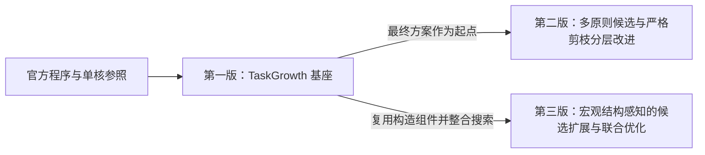

<h1 align="center">HuaweiCup2026A · 多核任务划分与调度</h1>
<p align="center">操作—张量 DAG 上的 Task 构造、多原则分层改进与基座专项优化</p>
<p align="center"> </p>
<p align="center"><a href="#第一问模型谱系">模型谱系</a> · <a href="#项目目录">目录</a> · <a href="#问题一第二版基于严格剪枝的多原则候选方案分层改进策略">第二版</a> · <a href="#问题一第三版基于宏观结构感知的候选扩展与联合优化算法">第三版</a> · <a href="docs/q2/baseline.md">问题二新基座</a> · <a href="#日常协作">协作</a></p>

本项目研究华为杯题目中的多核调度：划分原始计算图的子图、按场景组织 Task，决定核心分配与执行顺序，在依赖、片上容量和共享 DDR 带宽约束下，以官方模拟周期评价方案。第一问现保留基座、第二版和第三版三套模型；第二问实现了联动生长与窗口缓存排序的新基座。各自的搜索与评价规则单独记录。

私有仓库由 `Kk111777` 与 `Zysishuiyears` 通过任务分支和 PR 协作维护；基础环境为 Python 3.12，程序仅依赖标准库。赛题图是算子调度工作负载，求解过程不实际执行神经网络矩阵运算。

## 第一问模型谱系

| 版本 | 模型与关系 | 代码与命令 |
|---|---|---|
| 第一版 V1 | TaskGrowth 基座：双作用域、自适应 β、官方预分析与核心列表分配 | `q1/partition.py`、`solver.py`；`python tools/reference_problem1.py solve ...` |
| **第二版 V2** | **基座 + 基于严格剪枝的多原则候选方案分层改进策略**：先取得 V1 的最终方案，再按五原则、三层搜索严格改善官方目标 | `q1/stage2/`；`python src/solve_problem1.py improve ...` 或 `improve-batch ...` |
| 第三版 V3 | 基于宏观结构感知的候选扩展与联合优化算法：TaskGrowth 构造与结构候选、近似评估、局部改进和多状态搜索整合到统一控制器 | `scheduling/`、`q1/unified/`、`q1/improvement/`；`python src/solve_problem1.py graph.json --config ... --cores 2 3 4 5 --output ...` |



**模型编号表示方法关系，不按上传顺序编号。** V1 的默认自适应基座在 [`04634a2` / PR #4](https://github.com/Kk111777/HuaweiCup2026A/pull/4) 合入，完整 400 组合结果由 PR #5 归档；V3 在 [`6352e01` / PR #6](https://github.com/Kk111777/HuaweiCup2026A/pull/6) 先行合入，V2 随后由 PR #7 补齐。本次更新 V3 的结构驱动求解与接口。V2 与 V3 是从 V1 发展的两条路线，不构成 V1 → V2 → V3 的逐级叠加，也不把 V2 的三层搜索自动接入 V3。

V2 的候选接受依据是完整官方目标 `(makespan, added_copy_bytes)` 严格字典序改善，最终方案落盘后再次官方复评。V3 保持既有的近似接纳与官方校准规则，输出须区分 `score_source` 并按其说明独立重放。版本编号不代表逐例成绩优劣；三版比较必须使用相同 case 集合、核数与官方评分口径。

## 项目目录

```text
HuaweiCup2026A/
├─ src/
│  ├─ problem_1_baseline.py       # 官方单核参照入口
│  ├─ solve_problem1.py           # V2 子命令 / V3 默认图路径入口
│  ├─ solve_problem2.py           # Q2 solve / batch / verify
│  ├─ common/baseline.py          # 基线归档校验及加速比计算
│  ├─ common/artifacts.py         # 原子写入、JSON 和 SHA-256
│  ├─ scheduling/                # V3 公共编排、四组问题接口、预算与评估服务
│  ├─ q2/                        # Q2 增量构造、Step1 前缀、窗口 DP 与官方复核
│  └─ q1/
│     ├─ graph.py, model.py       # 共享图模型与基座索引
│     ├─ partition.py, solver.py # V1 TaskGrowth 构造及初始化择优
│     ├─ schedule.py, allocation.py, official.py  # 调度与官方适配
│     ├─ reference_cli.py, run.py # V1 参考运行，兼容导出公共产物函数
│     ├─ stage2/                 # V2：诊断、邻域、严格下界、三层搜索
│     ├─ unified/                # V3：Q1 适配器、结构特征、候选与兼容入口
│     └─ improvement/            # V3：结构候选、近似评价与局部改进
├─ configs/
│  ├─ q1/stage2.json             # V2 搜索预算、规模及剪枝开关
│  ├─ q2/                        # Q2 算法参数与已审官方 SHA-256
│  └─ unified.json               # V3 既有配置路径，保留兼容性
├─ tools/reference_problem1.py   # V1 的显式命令行入口
├─ scripts/run_unified_100.ps1   # V3 既有批量实验入口
├─ official/                    # 原版评估代码、配置；原始图留本地
├─ docs/q1/                     # initialization / stage2 / unified 三版说明
├─ docs/q2/                     # 设计原稿、实现使用与有限验收
├─ tests/                       # 共享基础、Q1 回归、Q2 独立 oracle 与边界验证
├─ results/
│  ├─ problem_1_singlecore/      # 已发布单核参照，固定保留
│  └─ q1_adaptive_100cases_20260925/ # V1 完整百例归档
└─ outputs/                     # 各版本实验目录，Git 忽略
```

目录沿用已验证的导入和运行路径，Q1 共享基座保持一份实现，V2 和 V3 的搜索模块分别归位；Q2 独立实现 Scene B 的构造与排序，第三问尚无实现。具体接口与实验归档约定见[项目结构说明](docs/architecture.md)。

## 开始使用

先接受私有仓库邀请，再克隆项目：

```powershell
git clone https://github.com/Kk111777/HuaweiCup2026A.git
cd HuaweiCup2026A
```

已有本地项目的成员在现有目录继续工作，不需要重复克隆。环境准备见 [Python 环境说明](docs/environment.md)。

## 问题一：单 Task、单核基线

### 准备官方材料

将赛题 PDF 和附件压缩包保留在项目根目录。首次准备时，用 Python 3.12 将附件完整解压到 `official/`：

```powershell
python -m zipfile -e "通用神经网络处理器下的多核调度问题  附件.zip" official
```

`official/` 中的代码、说明和 `data/config.txt` 保持原样。已有官方材料时不要用不同版本覆盖；正式输入应为 `data/case_001.json` 至 `data/case_100.json`。约 253 MB 的原始计算图、压缩包和 PDF 不纳入 Git，其他成员需自行从同一附件准备数据。

### 计算口径

官方 `singlecore_evaluate.py` 将全部非 `COPY_IN`/`COPY_OUT` 操作映射到子图 0，采用 `core_schedules=[[0]]`。边界 COPY、缓存换入换出、四条 Pipe 的调度与共享 DDR 带宽模拟全部由官方代码完成；不使用随机切图示例生成基线。

最终耗时取结果 JSON 顶层的 **`makespan`，单位为 cycles**。`step3_by_task` 中的 `local_makespan` 只用于核内排布，不能替代最终指标。一个核心仍可以并行执行不同 Pipe；这里的单核指模拟的 NPU 核心数量。Python 实际运行秒数另记为 `runtime_seconds`，不用于加速比。

固定配置为 L1=524288 bytes、UB=131072 bytes、DDR=60 bytes/cycle，同核 Task 等待 100 cycles、跨核前驱等待 1000 cycles。本基线仅有一个从 0 时刻启动的 Task，不发生 Task 间等待；缓存不足时仍允许官方程序插入 Spill。入口通过 SHA-256 检查附件配置，不能通过参数改动评测数值。

### 运行

以下命令中的 `python` 应指向 Python 3.12；Windows 可替换为 `.\.venv\Scripts\python.exe`，无需激活环境或安装第三方库。

```powershell
# 全部 100 个正式用例，按 CPU 数自动选择并发数（最多 8 个）
python src/problem_1_baseline.py

# 指定同时运行 8 个官方评估进程
python src/problem_1_baseline.py --workers 8 --output-dir outputs/singlecore_parallel

# 中断后在原输出目录续跑，已验证的成功用例不重新计算
python src/problem_1_baseline.py --workers 8 --resume

# 单例；含空格的路径请加引号
python src/problem_1_baseline.py official/data/case_001.json --output-dir outputs/case_001_check

# 自选目录，只读取其中的 case_*.json
python src/problem_1_baseline.py path/to/cases --output-dir outputs/subset_check

# 单元与集成测试（无需跑完正式用例）
python -m unittest discover -s tests -v
```

默认全量输入必须完整覆盖 001–100。每例完成后立即保存并更新汇总；单例失败会记录原因并继续，其余输入的原始内容不会被修改。全部成功时退出码为 0，存在失败或准备条件不满足时为 1，手动中断时为 130。大图可能运行较久，不设置隐式超时；打印 `[START]` 而尚未打印结果的用例仍在运行。

默认并发数取逻辑 CPU 数的一半，至少 1 个、最多 8 个；可用 `--workers 1` 串行运行。线程池仅负责管理独立 Python 子进程，实际模拟在多个 CPU 核上执行。大文件优先开始，汇总始终按用例编号排序。增加并发缩短的是整批耗时；每个评估进程仍然模拟一个 NPU 核心和一个 Task。程序处理的是图依赖和事件时间，不实际执行神经网络的矩阵计算，也没有 GPU 计算接口。

新实验的输出目录必须为空。重复实验请指定新的 `--output-dir`；继续同一实验时显式传 `--resume`。续跑会核对全部输入、配置及官方代码的 SHA-256，并重新读取已成功用例的结果、Trace 和日志，确认与汇总一致后才复用；来源变化或成功产物损坏时拒绝续跑。失败或未完成用例会重新评估，更新其原有产物。不要手工修改汇总或计算图来混合不同实验。

按 Ctrl+C 后取消尚未开始的用例，等待正在运行的进程结束并保存，再用 `--resume` 继续。强制关闭窗口或进程后也可续跑；未记入成功汇总的用例会重算。输出目录的 `.run.lock` 是操作系统文件锁，防止两个批处理同时写入；进程退出即释放锁，文件本身保留，不要在运行时删除。官方调度是确定性的，本入口不使用随机过程，不需要随机种子。

### 输出与验收

默认输出目录结构为：

```text
outputs/problem_1_singlecore/
  summary.csv
  run_info.json
  case_001/
    case_001_singlecore_res.json
    case_001_singlecore_trace.json
    case_001_singlecore_log.txt
  ...
  case_100/
    ...
```

三类逐例文件保持官方格式。Trace 可在 Perfetto 中打开。`summary.csv` 使用带 BOM 的 UTF-8，便于直接用 Excel 查看，各字段含义如下：

| 字段 | 含义 |
| --- | --- |
| `case`、`status` | 用例名称及 `ok` / `failed` 状态 |
| `makespan_cycles` | 最终模拟耗时，取官方 `makespan` |
| `original_graph_copy_bytes`、`scheduled_copy_bytes` | 原始图及调度后的 COPY 搬运量 |
| `added_copy_bytes` | 调度后搬运量减去原始搬运量 |
| `partition_added_copy_bytes`、`spill_added_copy_bytes` | 边界重建及缓存换入换出各自产生的额外搬运量 |
| `l1_peak_bytes`、`ub_peak_bytes` | 官方报告的核内缓存峰值 |
| `runtime_seconds`、`error` | 调用与检查程序的实际秒数，以及失败原因 |

失败行的评测数值留空，不能参与成功结果统计。`run_info.json` 保存解释器、平台、参数、官方代码及配置和每份输入的 SHA-256、运行起止时间、完成数及状态；`invocations` 记录每次运行的入口版本、并发数、复用数量和实际批处理秒数，总 `runtime_seconds` 表示从首次开始到最后结束的历时（含续跑间停顿）。`status=complete` 才表示本次运行全部成功。中断时已完成结果保留，完成数不足的记录不构成全量实验。

入口检查单核、单 Task、起始时刻、依赖与流量、操作时间线末端、内存峰值，以及结果、Trace、日志的一致性。全量验收要求汇总恰好 100 行且全部 `ok`，同时拥有 100 组完整的三类官方产物。单核加速比定义为 1；后续多核加速比逐例使用本表的 `makespan_cycles` 除以对应多核耗时，再对全部用例的加速比取平均。

已核对的参考值：附录 B.7 最小图为 **6 cycles**；`case_001` 为 **233110 cycles**；`case_003` 为 **602212 cycles**。完整结果见[已归档的 100 例汇总](results/problem_1_singlecore/summary.csv)。

2026-09-23 在 Python 3.12.14 下完成全量复现：**100/100 成功，300 个官方产物齐全**，其中 40 个用例产生 Spill。前 57 个成功用例原样复用，后 43 个用例以 8 进程并行完成，该并行阶段耗时约 467 秒。17 项测试通过；全量结果另已核对操作覆盖、原始计算依赖时序、同 Pipe 不重叠，以及 Trace、日志、汇总和源码/数据校验值的一致性。

### 已上传的完整结果

[单核 baseline 结果归档](results/problem_1_singlecore/README.md)保存 100 例的 300 份官方产物、汇总和运行记录，附本次上传的 SHA-256 清单和核验记录。日常新实验仍写入被 Git 忽略的 `outputs/`，完成并明确要求上传后才整理为正式结果。

## 问题一第二版：基于严格剪枝的多原则候选方案分层改进策略

V2 = V1 最终方案 + `q1.stage2`。数据局部性、管道协同、Task 边界时序、DDR 竞争、多核负载五类原则产生候选；依次进行排程改进、切分/合并域搜索、局部联合搜索。结构检查、B0/B1 和 DDR 下界排除不能改善的分支，完整官方评价决定接受；接受后重新诊断并回到第一层。

```text
initial = V1 的最终方案
while 预算允许:
    从当前官方执行结果诊断候选
    按三层顺序生成候选或局部域，先严格剪枝，再精确评价
    若发现 (总周期, 额外搬运) 严格字典序改善：接受并回到第一层
    若本轮未接受改善：结束，记录是否仍有预算截断的域
落盘后独立调用原版官方入口复评，通过后写 complete.json
```

```powershell
# 新图先运行基座，生成四种核数的初值
python tools/reference_problem1.py solve official/data/case_001.json --cores 2 3 4 5 --output-root outputs/q1_v1

# 单组合：从基座的已验收结果启动第二版
python src/solve_problem1.py improve official/data/case_001.json --initial-plan outputs/q1_v1/case_001/N2/plan.json --search-config configs/q1/stage2.json --output-root outputs/q1_v2

# 直接读取仓库已有的 V1 百例 ZIP 归档；并发数按实际 CPU/内存配额选择
python src/solve_problem1.py improve-batch --initial-root results/q1_adaptive_100cases_20260925 --cases all --cores 2 3 4 5 --jobs 8 --search-config configs/q1/stage2.json --output-root outputs/q1_v2 --resume
```

`src` 在模块搜索路径中时，也可使用 `python -m q1.stage2 improve ...`。保持原 `improve` / `improve-batch` 命令可用；不改变 V3 的图路径语法和默认行为。

默认每组合搜索 1800 秒、每局部域 120 秒及 256 次兼容评价预算；`--jobs` 控制实际 CPU 工作进程，`--cores` 表示模拟 NPU 核数。实现复用只读 Task 模板、分区/B1 结构及精确结果缓存；二级缓存命中仍消耗原预算名额。严格剪枝不等于全图最优保证：原则短名单、规模约束、时间及评价上限仍限制搜索范围。配置变化、源码更新与限时运行的差异都须单独记录。

算法、公式与字段见[第二版说明](docs/q1/stage2.md)，有限测试及性能测量见[验收记录](docs/q1/stage2_acceptance.md)，运行与跨版本继承见[服务器指南](docs/q1/stage2_server.md)。本次发布代码与验证说明，不上传尚在运行的服务器实验、不把实时部分均值当作百例最终成绩。

## 问题一第三版：基于宏观结构感知的候选扩展与联合优化算法

第三版沿用 PR #6 的基座构造与统一搜索路线，现已移除单核成绩对前置求解和全图策略的依赖，并将公共编排移入 `src/scheduling`。图路径入口继续可用，第二版 `improve` / `improve-batch` 分流保留；其与第二版的关系见上方[模型谱系](#第一问模型谱系)。

第三版复用图校验、COPY 节点收缩、拓扑预处理与 TaskGrowth 子图生长实现。由图的依赖链、分量、计算和搬运负载、内存压力等特征安排搜索，默认以共享近似模型的局部时长进行预分析。保链、阶段、内存优先和后支配区域候选配合局部拆分合并、多 Task 区域重构及多状态搜索，共用调度内核与评估服务。原基座参考入口的官方预分析仍保留。

第三版将协作者的 Task 生长策略与个人的结构候选、局部改进及区域重构放入同一个搜索控制器，共用图模型、方案校验、调度内核、官方评估服务和预算。第三版内部没有两个独立求解管线及最终择优汇合点；第二版仍由自己的显式子命令调用。

当前统一入口允许近似改进立即覆盖方案；官方评估在时间充足时按批次或计时间隔校准。来不及核验时保留近似结果，`score_source` 标明来源；离线重放另存真实评分，不改写原始预测值。架构与接口规则见 [统一说明](docs/q1/unified.md)。

```powershell
python src/solve_problem1.py path/to/new_graph.json --config official/data/config.txt --cores 2 3 4 5 --seconds 600 --output outputs/new_graph
```

输入可为任意名称的合法新图。一张图的全部请求核数共享 600 秒目标预算，包含预处理、搜索内官方调用及输出；保留有条件延至 900 秒、已启动工作最多至 1200 秒的项目保护机制。求解不先运行官方单核，固定单核结果仅在报告层用作加速比分母。单图内各核数和候选均串行，本地批量测试可显式并发不同 case。

公共框架以 `PlanSemantics / ExecutionModel / PredictionModel / ProposalSet` 四组接口绑定 Q1；旧 `q1.unified` 导入路径保持兼容，新增 `scheduling.api.solve_case(..., problem='q1')` 与 `python -m scheduling --problem q1 ...`。后续 Q3 需实现相应语义、执行/预测与候选模块再注册，目前尚未接入。接口层级图与调用示例见 [接口说明](docs/q1/interfaces.md)，最终要求核对、搬运字段修复及验证见 [合并前复核](docs/q1/merge_review.md)，初次发布与历史成绩取舍见 [验收说明](docs/q1/modular_validation.md)。

详见[彩色分层架构、模块归属、调用与时间口径](docs/q1/unified.md)。新成绩与逐例耗时写入新实验目录；旧版两管线择优的成绩不代表本版本。

原 `initialize` 保留为串行基座对照 API。旧命令行移到 `tools/reference_problem1.py` / `q1.reference_cli`，其中候选并发被禁止。历史公式说明见 [初始化算法](docs/q1/initialization.md)，其中旧入口和并发说明以本页与统一架构文档为准。

## 问题二：联动生长与精确窗口缓存排序新基座

Q2 将每核全部子图合成一个 Task，跨核 COPY 等待 500 cycles。持续核心状态、四类短名单和增量试放负责构造；默认沿用 Q1 的自适应 β 规则：每种模式从 β=1、2 开始，官方 makespan 严格下降才继续，最多 β=4。B0 取所有已成功评价候选中的官方字典序最优方案；再固定子图成员和核心归属，以至多 32 个、宽度至多 8 的子集 DP 窗口优化无换出归一化缓存峰值。增强方案 B1 只有在官方 `(makespan, added_copy_bytes)` 严格改善时才被保留。最终方案落盘重读，并用原版官方 CLI 全字段复评后才发布。

```powershell
# python 指向 Python 3.12；先运行单例
python src/solve_problem2.py solve official/data/case_001.json --cores 2 --output-dir outputs/q2_single

# 自适应 β 消融：只试 β=1；grid 则完整尝试配置中的 β
python src/solve_problem2.py solve official/data/case_001.json --cores 2 --beta-search fixed --output-dir outputs/q2_fixed

# 显式限定六个冒烟组合，默认串行；不会扩展到其他 case
python src/solve_problem2.py batch --data-dir official/data --cases case_001 case_067 case_086 --cores 2 5 --workers 1 --wall-seconds 90 --verification-reserve 15 --output-dir outputs/q2_smoke
```

默认预算为每 case/N 600 秒，预留 60 秒复核；单核分子读取并校验现有固定归档。续跑须使用相同来源和参数并显式加 `--resume`，自定义小图可用 `--without-baseline`。没有运行 100×4 全量实验。当前版本 `Q2-Baseline-AdaptiveBeta-1.1` 的搜索、消融与验证边界见[自适应 β](docs/q2/adaptive_beta.md)；通用运行和旧版六组合记录见[Q2 实现与验收](docs/q2/baseline.md)。[设计原稿](docs/q2/design.md)保留 1.0 的交接内容，初始化的变更以当前版本说明为准。

## 日常协作

### 协作者算法完整 100 例实验（2026-09-25）

[完整实验归档](results/q1_adaptive_100cases_20260925/README.md)保存提交 `04634a2` 的默认自适应算法在 100 例、2/3/4/5 核上的全部 400 份验证结果。20 个 CPU 进程运行 10239.945 秒；百例平均加速比分别为 **1.832685、2.463278、2.933060、3.338753**。归档包含可直接提交的方案包、子图调度排布、逐例墙钟/CPU 时间、日志、Trace、来源指纹及无损压缩的完整 case 产物。

1. 开始新任务前，确认工作区干净，更新本地 `main`。
2. 为每项任务创建 `feat/<用户名>/<任务>` 或 `fix/<用户名>/<任务>` 分支。
3. 修改和验证程序；需要上传时，检查改动后提交并推送自己的分支。
4. 创建面向 `main` 的 PR，说明改动和验证方法，约定由另一位成员审核后合并。
5. 使用 **Squash and merge** 合并；随后更新本地 `main`，下一项任务重新建分支。

双方均可提交、审核和合并 PR。免费个人私有仓库采用团队约定，不将审核规则描述为平台强制保护。

详细协作指南和 PR 模板由首个协作配置 PR 加入，合并前可在该 PR 分支阅读。

## 在 Codex 中操作

日常修改默认只保留在本地。

- “提交”：检查后创建本地 Git 提交，不自动上传。
- “同步上传”或“上传”：检查改动及远端状态，完成适用验证，提交并推送当前任务分支，创建或更新 PR。
- “合并 PR”：作为单独操作，需要明确指示。

本项目没有后台自动提交、定时上传或自动合并任务。首次建仓与首个协作 PR 按本次初始化授权完成。

## 文件管理

代码、Notebook、项目说明和 `results/` 下明确归档的正式结果纳入版本管理。虚拟环境、缓存、本机凭据、临时文件和 `outputs/` 下的运行产物不提交。需要作为正式成果保留的图表和文档可放入 `docs/`。比赛数据加入前检查是否适合共享及文件大小；不将完整原始数据直接塞进提交历史。
