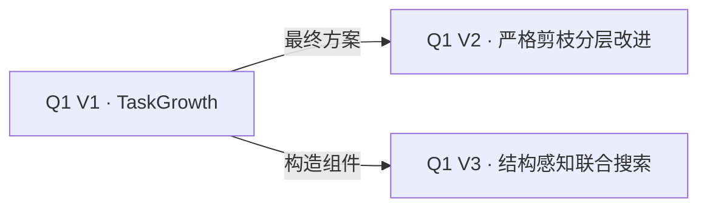
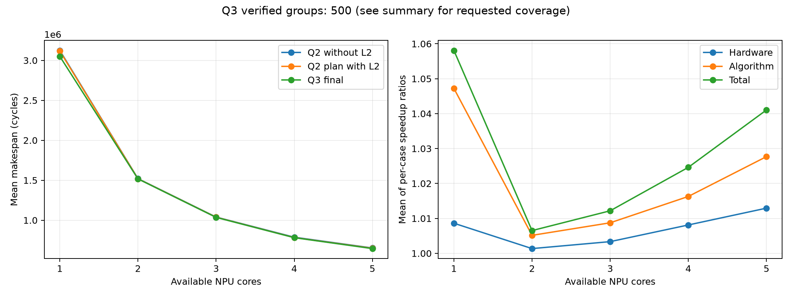

<h1 align="center">2026 华为杯 · 多核 NPU 图调度</h1>
<p align="center"><strong>面向 NPU 计算图的多核调度与存储优化</strong></p>
<p align="center"><b>简体中文</b> · <a href="README.en.md">English</a></p>
<p align="center">
  <a href="https://github.com/Kk111777/HuaweiCup2026A"></a>
  
  
  
  
</p>
<p align="center">
  <a href="#overview">问题概览</a> · <a href="#quick-start">快速开始</a> ·
  <a href="#models">模型演进</a> · <a href="#results">实验结果</a> ·
  <a href="docs/README.md">文档索引</a> · <a href="docs/data.md">题面与数据</a>
</p>

本项目研究 **NPU 计算图上的多核调度与存储协同优化**：给定操作—张量 DAG，在依赖、片上容量与共享带宽约束下，联合决定子图划分、核心分配和执行顺序，优化模拟周期与数据搬运。

大语言模型的高效执行需要同时处理计算与数据供给。Attention、线性投影和前馈网络中的操作具有先后依赖，中间张量占用有限的快速存储；执行顺序会改变张量的存活时间与复用机会，而切分计算以增加并行度，也可能带来更多通信和内存换入换出。对系统而言，**在哪里计算、按什么顺序计算、让哪些数据保持驻留**，是相互影响的决策。

这与 LLM 系统中的几个研究方向形成了自然联系。**IO 感知算子优化**关注计算与搬运的共同成本：[FlashAttention](https://arxiv.org/abs/2205.14135) 通过分块减少 HBM 与片上 SRAM 之间的读写。**存储分层与 offloading**关注容量受限时的数据放置和访问计划：[FlexGen](https://proceedings.mlr.press/v202/sheng23a.html) 协调 GPU、CPU 与磁盘资源来支持高吞吐 LLM 推理。**图编译与自动并行化**则研究如何将带依赖的计算映射到执行资源：[Alpa](https://arxiv.org/abs/2201.12023) 在大模型分布式训练中联合规划算子内与算子间并行。这些工作的具体系统和尺度各异，共同说明了计算图结构、存储容量和通信代价需要协同考虑。

本项目将这一研究视角落实为可检查的图论与组合优化问题。三个赛题场景依次研究 **多 Task 划分与调度、核内存储共享、共享 L2 缓存复用**，以启发式构造、局部搜索、动态规划和官方事件模拟评价不同策略。项目源于华为杯 A 题《通用神经网络处理器下的多核调度问题》，使用其 100 张原始计算图；与上述研究的联系在于调度和存储决策的结构，当前结果衡量官方模型中的模拟周期与搬运量，不直接衡量真实 LLM 的 token 吞吐或端到端时延。

仓库所有者为 [Kk111777](https://github.com/Kk111777)，协作者为 [Zysishuiyears](https://github.com/Zysishuiyears)。代码与实验由团队通过任务分支和 PR 协作维护；各归档保留具体源码与贡献来源。

### 结果速览

| 图划分与调度 · Q1 V3 | 片上存储优化 · Q2 v3 | L2 复用 · 已发布 Q3 |
|:---:|:---:|:---:|
| **4.297×** 平均加速比 | **4.185×** 平均加速比 | **500 / 500** 官方复评通过 |
| 100 图 · 5 核 · 相对固定单核 | 100 图 · 5 核 · 相对固定单核 | 100 图 · 1–5 核 · 冻结 Q2 对照 |

[查看各版完整结果、预算与来源](#results)

<a id="overview"></a>
## 问题概览

输入为 `ops`、`tensors`、`edges` 构成的 DAG。方案通过 `node_to_subgraph` 划分计算操作，通过 `core_schedules` 指定各核上的子图次序；官方程序进一步生成核内调度、容量约束与事件时间线。

| 问题 | 执行模型 | 优化重点 |
|---|---|---|
| Q1：多 Task 调度 | 每个子图形成一个 Task，存在同核／跨核前驱等待 | 子图边界、核心负载、Task 顺序与 DDR 竞争 |
| Q2：核内共享存储 | 同一核心的子图合并为一个 Task，跨核通过 COPY 通信 | 联动划分与分核、核内顺序、L1/UB 容量与 spill |
| Q3：共享 L2 缓存 | 在 Q2 的执行模型上增加只读 FIFO L2 | 数据复用窗口、容量重排、周期与搬运折衷 |

官方输出 `makespan` 的单位是 **cycles**，搬运量的单位是 **bytes**。搜索可使用近似模型；正式结果以对应问题的官方评估为准。实现分别提供：

- Q1 的 TaskGrowth 基座、严格剪枝分层改进，以及结构感知联合搜索。
- Q2 的修复基座、容量窗口排序和独立优化模型。
- Q3 的固定 Q2 方案优化，以及继承完整 Q1/Q2 方案的 Q3v3。
- 按版本保存的方案、指标、来源哈希和验证记录；归档具体覆盖范围见[实验结果](#results)。

### 研究脉络：从缓存调度到多核协同

本项目延续 [2025 华为杯 Cache-NPU 调度项目](https://github.com/Zysishuiyears/2025Huaweicup_Cachenpuscheduling) 对 **DAG、片上存储与数据搬运协同优化** 的研究方向。

| 项目 | 工作负载 | 主要决策 |
|---|---|---|
| [2025 Cache-NPU Scheduling](https://github.com/Zysishuiyears/2025Huaweicup_Cachenpuscheduling) | 6 个 SIMD/NPU 图，覆盖 FlashAttention、Matmul、Conv | 拓扑执行序列、连续地址分配、SPILL 选择与流水压缩 |
| **2026 Multicore NPU Scheduling** | 100 个操作—张量 DAG，三个官方执行场景 | 子图划分、核心分配、Task 顺序、容量排序与共享 L2 复用 |

研究重点从缓存压力下的图执行与内存分配，扩展到多核任务边界、共享带宽竞争和 L2 数据复用。两年项目分别使用自己的输入格式、约束及评估器，结果按各自定义解读。

<a id="quick-start"></a>
## 快速开始

### 环境与输入

使用 **Python 3.12**。求解器只依赖标准库；Q3 报告绘图可选安装 `requirements-q3.txt`。仓库目前为私有仓库，需要访问权限。

```bash
git clone https://github.com/Kk111777/HuaweiCup2026A.git
cd HuaweiCup2026A
python --version
python -m venv .venv
```

后续 `python` 指向 Python 3.12 环境；Windows 可直接使用 `.\.venv\Scripts\python.exe`，macOS/Linux 可用 `.venv/bin/python`，无需修改系统环境。详见[环境说明](docs/environment.md)。

[原版题面 PDF](official/通用神经网络处理器下的多核调度问题.pdf)、100 张原始计算图和原始配置已随仓库提供。首次运行先按[数据说明](docs/data.md)核对 `official/inputs.sha256`；无需另找附件或手动改动官方参数。

### 单图运行

以下示例均从仓库根目录执行，使用不同输出目录。先运行所需的一条；`--cores 2` 表示模拟两个 NPU 核心。

```bash
# Q1 V3：结构感知联合搜索
python src/solve_problem1.py official/data/case_001.json --config official/data/config.txt --cores 2 --seconds 600 --output outputs/demo_q1

# Q2 v3：基座优化模型
python src/solve_problem2_optimized.py solve official/data/case_001.json --cores 2 --seconds 600 --output outputs/demo_q2

# Q3：复用已归档的 Q2 输入，关闭可选绘图
python src/solve_problem3.py solve official/data/case_001.json --cores 2 --no-plots --output-dir outputs/demo_q3
```

Q1/Q2 v3 的默认预算是每图所有请求核数共享 600 秒目标，另有 900 秒条件延长与 1200 秒保护；这不是每个核数各有 600 秒。Q3 默认每图共享 600 秒，缺失 Q2 输入时的生成时间单列。主机并发参数 `--workers` / `--jobs` 与模拟核数 `--cores` 含义不同。

旧版入口、Q3v3 的完整方案起点和输出格式见下方模型表及[文档索引](docs/README.md)。重新搜索受版本、预算和机器负载影响；只核对已发布成绩时，使用各结果归档中的**独立复评命令**。

<a id="models"></a>
<a id="第一问模型谱系"></a>
## 模型演进与方法

### Q1：Task 构造与多核调度

| 模型 | 方法与关系 | 入口与说明 |
|---|---|---|
| V1 | 全局／分量范围的就绪节点生长，自适应 β，官方核内预分析与列表分核 | `tools/reference_problem1.py solve`；[基座](docs/q1/initialization.md) |
| V2 | 从 V1 最终方案出发，按五类诊断原则生成候选，进行排程、拆分／合并和局部联合三层搜索 | `src/solve_problem1.py improve`；[分层改进](docs/q1/stage2.md) |
| V3 | 复用 TaskGrowth，整合结构候选、近似评价、局部重构与多状态搜索 | `src/solve_problem1.py graph.json`；[统一搜索](docs/q1/unified.md) |



V2 接受候选 $p'$ 的条件为

$$
\bigl(T(p'), B_{\mathrm{added}}(p')\bigr)
<_{\mathrm{lex}}
\bigl(T(p), B_{\mathrm{added}}(p)\bigr),
$$

其中 $T$ 为官方总周期，$B_{\mathrm{added}}$ 为额外搬运量。接受后重新诊断，从第一层继续；严格下界只排除其适用条件内不能改善的分支。

V2/V3 是 V1 的两条派生路线。V3 允许近似接纳并进行官方校准，原始 `score_source` 可能不同；正式百例成绩统一采用冻结方案后的独立官方复评。三个模型均不声称全局最优。

### Q2：联动划分、分核与容量排序

| 版本 | 方法与状态 | 入口与说明 |
|---|---|---|
| 1.1 | 早期新基座，存在已知算法问题，保留作历史对照 | [旧版归档](archive/q2/baseline_1_1_known_issues/README.md) |
| 2.0 / 2.1 | 修复基座：联动生长、顺序保真编码、整分量同核候选及容量窗口 DP；2.1 补齐复用接口 | `src/solve_problem2.py solve`；[修复设计](docs/q2/repair.md) |
| v3 | 在基座组件上加入粗／细事件模型、重排、迁核、块调整与容量修复的统一搜索 | `src/solve_problem2_optimized.py solve`；[优化模型](docs/q2/OPTIMIZED_MODEL.md) |

```text
构造／范围／编码流分别维护 β
    → 生成并验证候选 → 官方反馈决定继续或停止
    → 发生 spill 时尝试容量窗口排序
    → 按官方 (cycles, added_copy_bytes) 择优
    → 最终方案落盘、重读、独立官方复评
```

自适应 β 遇到周期持平或下降时继续，严格增加时停止。窗口 DP 的局部精确性不等于整图最优。v3 通过精确成绩确认接受；若当次基座保底未完成，则不具备完整基座不退化保证。工程编号 v3 对应问题二的第二个数学模型，详见[版本与固定标签](docs/q2/VERSIONS.md)。

### Q3：L2 优化与周期／搬运折衷

| 模型 | 起点与目标 | 入口与说明 |
|---|---|---|
| 已发布 Q3 | 冻结 Q2 方案，在 Q3 下评价并搜索；按官方周期、额外搬运量严格接受 | `src/solve_problem3.py`；[运行说明](README_Q3.md) |
| Q3v3 | 继承完整 Q1/Q2／可选旧 Q3 方案，重新按 Q3 评价；容量重排、L2 窗口与联合搜索 | `src/solve_q3v3.py`；[运行说明](README_Q3V3.md) |

Q3v3 默认工程目标为

$$
J(p)=\frac{T(p)}{T_{\mathrm{ref}}}
+0.05\left(0.75\frac{D(p)}{D_{\mathrm{ref}}}
+0.25\frac{A(p)}{A_{\mathrm{ref}}}\right),
\qquad T(p)\leq 1.01\,T_{\mathrm{fastest}}.
$$

$D$ 为实际 DDR 字节，$A$ 为额外 COPY 字节，正归一化分母由起点固定；$T_{\mathrm{fastest}}$ 是已发现可行方案的最快周期。该偏好允许最多 1% 的周期退让以减少搬运，并另存纯最快方案；它不是官方加权评分，也不以未知全局最优为基准。公式与边界见[完整算法](docs/q3v3_memory_traffic.md)。

<a id="results"></a>
## 实验结果与证据

### Q1 / Q2：相对固定单核参照

对每个核数 $N$，先计算同图比值，再对 100 张图取算术平均：

$$
\overline{S}_N=\frac{1}{100}\sum_{i=1}^{100}
\frac{T_{\mathrm{single}}(i)}{T_{\mathrm{official}}(i,N)}.
$$

| 模型与结果归档 | 2 核 | 3 核 | 4 核 | 5 核 | 覆盖 |
|---|---:|---:|---:|---:|---|
| [Q1 V1](results/q1_adaptive_100cases_20260925/README.md) | 1.832685 | 2.463278 | 2.933060 | 3.338753 | 400 组 |
| [Q1 V2](results/q1_stage2_100cases_20260926/README.md) | 1.921852 | 2.587793 | 3.102977 | 3.551904 | 400 组指标 |
| [Q1 V3](results/q1_structure_100cases_20260926/README.md) | 2.090409 | 2.939747 | 3.686617 | 4.296547 | 400 组 |
| [Q2 Repair 2.0](results/q2_repair_full_20260926/README.md) | 2.038162 | 2.775597 | 3.452734 | 3.991946 | 400 组 |
| [Q2 v3](results/q2_optimized_full_20260927/README.md) | 2.083251 | 2.880824 | 3.594802 | 4.184883 | 400 组 |

这些是各版已发布的历史实验，**不是相同搜索预算的受控排名**：

| 模型 | 源码身份与预算／证据边界 |
|---|---|
| Q1 V1 | `04634a2`；原生自适应 β 扫描，400 份方案与官方产物已归档 |
| Q1 V2 | 服务器源码指纹见归档协议；多轮历史／补跑逐例择优，基础搜索 1800 秒并有选择性加时；未发布全部最终方案和 Trace |
| Q1 V3 | 固定主线 `7471470`、运行工作区 `93be2aa`，附源码快照；每图跨核数共享 600/900/1200 秒预算，400 组独立复评 |
| Q2 Repair 2.0 | `11501c5`，标签 `q2-baseline-2.0`；每图每核数各 600 秒，400 组通过复评，其中 16 组搜索提前结束 |
| Q2 v3 | `29747d8`；每图跨核数共享 600/900/1200 秒预算，400 组通过复评；80 组提案耗尽，331 组完成当次基座保底 |

Q2 2.1 是保留基座算法的接口版本，不能将 2.0 的历史运行改标为 2.1 新实验。Q1 V3 的原始搜索分数含 43 组近似值，上表全部使用独立官方成绩。

辅助实验：[Q1 五组件消融，2400 行](results/q1_ablation_2400_20260926/README.md)；[V1 β 灵敏度，20 图 × 5 策略、仅 5 核](results/q1_sensitivity_5cores_20260927/README.md)。

### Q3：固定同核数 Q2 方案的 L2 收益

令 $T_2$ 为冻结 Q2 方案无 L2 的周期，$T_{2\to3}$ 为同一方案启用 L2 的周期，$T_3$ 为优化后周期。分别计算 $T_2/T_{2\to3}$、$T_{2\to3}/T_3$、$T_2/T_3$，再逐例取均值；三列均值不能直接相乘。

| 核数 | 平均硬件加速 | 平均算法加速 | 平均总加速 |
|---|---:|---:|---:|
| 1 | 1.008622 | 1.047241 | 1.058105 |
| 2 | 1.001360 | 1.005152 | 1.006514 |
| 3 | 1.003354 | 1.008749 | 1.012185 |
| 4 | 1.008125 | 1.016289 | 1.024626 |
| 5 | 1.012939 | 1.027696 | 1.041054 |

[已发布 Q3 归档](results/q3_full_20260927/README.md)覆盖 **500/500 组独立官方复评**，每图共享 600 秒。源码身份由 `provenance.json` 的逐文件哈希记录，发布基点为 `c20df63`；Q2 分子来自 Repair 2.0 档案，接口使用 Repair 2.1，N1 使用固定整图单核参照。263 组相对直接启用 L2 严格提速，237 组持平；`case_092/N3` 相对无 L2 的总加速比为 0.995674，保留在统计中。预算截断与评价超时见归档。

[Q3v3 修订 `q1q2-memory-traffic-1`](docs/q3v3_validation.md)验证了 **20 图／核数组合、40 份最终方案**，仅覆盖 2–5 核，每组上限 120 秒、64 次评价，准备与最终复评单列。相对冻结样本的旧 Q3，折衷方案 DDR 总字节下降 **48.490%**、spill 下降 **55.483%**；逐例周期降低率平均 **0.792%**，9 快／6 平／5 稍慢。纯最快方案为 10 快／10 平／0 慢。完整原始产物保留本地，该结果不代表百例或等预算冷启动比较。

<p align="center">
  
</p>

Q3 百例实验：平均周期与硬件／算法／总加速比。来源为已发布的 500 组归档，包含全部用例。

<a id="data"></a>
## 数据、输出与目录

每个 `case_*.json` 是一张具有指定算子周期、张量大小和依赖关系的调度工作负载。图规模、计算／搬运比例及张量复用决定不同的调度压力；仓库没有将这些编号标注为某个具体 LLM 或 GNN 模型。

| 输入字段 | 含义 |
|---|---|
| `ops` | 操作的 `id`、`op`、`pipe` 与 `cycles` |
| `tensors` | 张量的 `id`、存储位置 `pos` 与字节数 `size` |
| `edges` | 由 `source`、`target` 描述的有向依赖 |
| `config.txt` | 官方容量、带宽、Task／COPY 等待和 L2 参数 |

官方输出包括 `makespan`、搬运统计与事件 Trace；求解器另存方案、搜索记录及来源信息。不同版本的产物格式和归档完整度见对应运行文档，不能用哈希清单代替未发布的原始文件。

| 路径 | 内容 |
|---|---|
| `official/` | 原版题面、100 例数据、配置、评估代码及说明 |
| `src/q1/`、`src/q2/`、`src/q3/`、`src/q3v3/` | 各问题模型与独立入口 |
| `src/scheduling/`、`src/common/` | 共享搜索编排与产物／基线工具 |
| `configs/`、`tests/` | 算法参数、官方指纹与现有测试 |
| `docs/`、`results/` | 方法文档与按实验保存的正式结果 |
| `outputs/` | 本地新运行产物，Git 忽略 |

详见[数据来源与逐字节校验](docs/data.md)、[文档索引](docs/README.md)和[工程结构](docs/architecture.md)。

## 复现边界与协作

- 求解器为启发式方法；官方有效、搜索完成、局部域穷尽和全局最优是不同概念。
- 重跑历史实验需匹配归档的源码、参数与输入指纹。当前 `main` 不自动等同于每份归档的运行版本；墙钟限时也可能改变搜索轨迹。
- 本项目通过模拟周期评价调度质量，主机求解秒数单独记录，不作硬件吞吐或真实模型推理加速承诺。
- 项目开发使用 AI 辅助工具；代码审阅、官方复评和保存的来源记录共同支撑可检查的结论。
- 协作流程见 [AGENTS.md](AGENTS.md)。引用结果时请附对应归档与源码版本；仓库尚未单独指定项目许可证，官方题面、数据及评估程序保留原来源。
