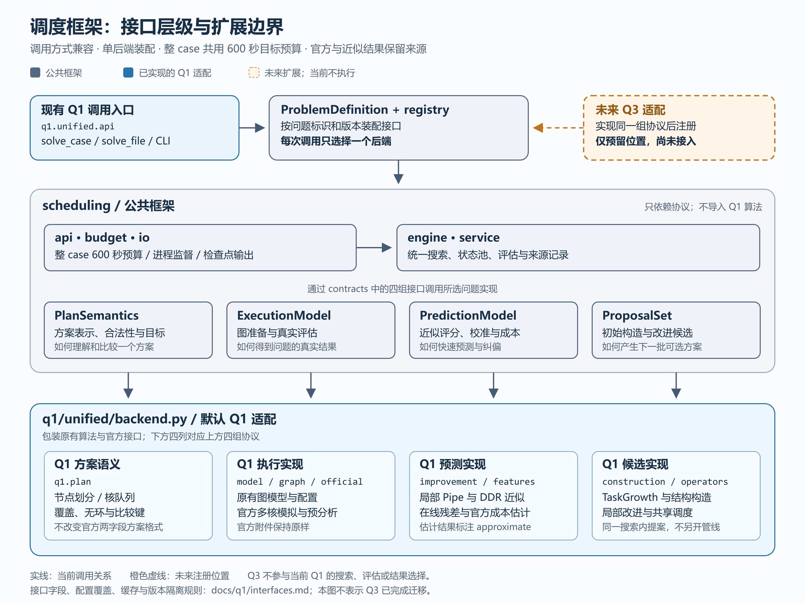

# 公共调度框架与 Q1 接口

本次工程化把预算、搜索编排、状态池、评估服务和运行产物移入 `src/scheduling`，将 Q1 的图、方案含义、官方执行、近似模型和候选算法通过适配器接回。**默认仍装配 Q1 第三个模型的现有实现，每次调用只选择一个问题后端。**没有同时求解 Q1、Q3 再择优的流程；Q3 尚未接入或注册到本公共框架。本地其他工作区的 Q3 独立实验不属于本次发布内容。

这次工作的目标是保持现有 Q1 行为，建立可检验的扩展边界。没有借重构调整搜索公式、默认预算、结构控制阈值或官方/近似接纳原则；case77 已观察到的微小收益判断问题也不在本次修复范围。

算法动机、TaskGrowth 与个人算子的关系见 [unified.md](unified.md)。本页说明工程接口、装配、配置与隔离规则；它不把工程化验证等同于新一轮完整 100 case 性能验收。

## 接口层级图

灰色和深蓝色表示公共框架，蓝色表示当前 Q1 实现，橙色虚线表示尚未接入的 Q3 扩展位置。



[打开可缩放 SVG](interface_hierarchy.svg) · [下载 PNG](interface_hierarchy.png)。图中四列一一对应四组接口；下方 Q1 算法由适配器提供给上方公共编排器。

## 代码分工与装配

| 文件 | 负责什么 | 不负责什么 |
|---|---|---|
| [contracts.py](../../src/scheduling/contracts.py) | 四组不可变接口绑定及 `ProblemDefinition`，检查绑定是否完整 | 不实现 Q1 或 Q3 算法 |
| [registry.py](../../src/scheduling/registry.py) | 从显式白名单解析问题标识，得到一个完整的问题定义 | 不从任意配置字符串导入模块，不自动枚举后端竞赛 |
| [api.py](../../src/scheduling/api.py) | 读入请求、共享准备、逐核调用、结果与来源记录 | 不自行解释某道题的图或计划格式 |
| [engine.py](../../src/scheduling/engine.py) | 统一候选处理、当前最优、有限状态池、校准与停止逻辑 | 不复制一条 Q1 管线与一条 Q3 管线 |
| [configuration.py](../../src/scheduling/configuration.py) | 校验调用方显式声明的结构参数覆盖 | 不默默改变旧默认策略，也不改硬件配置 |
| [service.py](../../src/scheduling/service.py) | 评估、预分析、缓存、检查点及错误边界 | 不把预测值改标为官方值 |
| [budget.py](../../src/scheduling/budget.py)、[io.py](../../src/scheduling/io.py) | 整 case 分级预算、进程监督、原子产物写入及文件摘要 | 不读取历史成绩决定搜索方向 |
| [Q1 backend.py](../../src/q1/unified/backend.py) | 将 Q1 原有函数绑定到四组接口，提供默认配置与版本 | 不再实现一套相同算法，不在模块全局切换另一套后端 |
| `src/q1/unified/api.py`、`engine.py` 等兼容入口 | 保留旧导入路径及调用方式，转入公共实现并显式提供 Q1 绑定 | 不维护与公共实现分叉的另一份主循环 |

公共算法模块通过接口访问问题实现，不静态导入 Q1 的图、算子或官方模拟器。`registry` 中的 Q1 白名单模块路径、公共入口的默认 `problem='q1'` 是装配配置；注册器在选中该问题后才加载它的适配器。这与“公共包中完全不出现 Q1 字符串”不同。

四组接口采用带 `frozen=True` 的 dataclass 保存函数绑定。绑定不可重新赋值，不代表估计器、缓存和搜索状态也不可变：这些运行对象由工厂为本次调用创建，不是全局共享单例。

## 四组接口的合同

以下名称以实际 [contracts.py](../../src/scheduling/contracts.py) 为准。接口保持原有 Q1 函数的调用签名，通过绑定适配已有算法，不要求把旧算法重写成新继承体系。

| 接口组 | 字段 | 默认 Q1 实现与含义 |
|---|---|---|
| `PlanSemantics` | `validate`、`key`、`objective`、`state_signature` | `q1.plan` 的覆盖/商图/队列验证、计划摘要、目标比较，以及原有状态去重语义 |
| `ExecutionModel` | `read_settings`、`settings_dict`、`create_model`、`create_index`、`evaluate`、`preanalyze`、`preanalysis_key`、`errors`、`empty_result` | 官方配置、`Graph`、`GraphIndex`、官方多核评估与预分析；声明预分析缓存身份、可恢复的调度异常及空图结果 |
| `PredictionModel` | `create_estimator`、`create_policy`、`create_cost_model`、`recognize`、`complexity`、`proxy`、`proxy_mode`、`proxy_note` | 近似事件模型、评估策略、官方耗时预测、图/方案特征与廉价筛选分数 |
| `ProposalSet` | `seed`、`create_constructor`、`initial`、`local`、`rebuild`、`schedule`、`retain`、`control_profile`、`controlled_parameters` | 结构种子、TaskGrowth 提案、结构初值、局部/区域重构、公共调度、状态保留与结构控制参数 |

`ProblemDefinition` 用 `id` 和 `version` 标识问题实现，将 `semantics`、`execution`、`prediction`、`proposals` 组合为一个整体，通过 `supported_cores` 声明支持的核数，以 `default_parameters` 提供默认参数读取函数，`artifact_files` 登记相关文件路径。当前默认定义是 `id='q1'`、`version='1'`、核数 `(2,3,4,5)`，相关配置为 `configs/unified.json`。注册器也接受调用方显式传入的完整 `ProblemDefinition`，便于测试或受控扩展；不完整定义和未知问题标识应立即报错。

接口还有以下搜索侧约定：

- 评估结果提供 `makespan` 和评分来源 `evaluation_source`，方案比较只通过 `semantics.objective`。Q1 的次级目标仍为新增搬运量，没有因为拆接口更换比较键。
- 估计器提供 `estimate`、`result`、`observe`、统计信息及有限方案缓存。`raw_cycles`、`pressure_risk` 等诊断用于搜索决策，不能据此把另一场景的时间线解释成 Q1 Task 时间线。
- 估计器工厂也可以返回 `None`：公共初始化会用 `execution.evaluate` 评估种子，可供只使用真实评估的后端接入；该后端仍须提供相容的评估策略和其他合同。默认 Q1 工厂继续返回原近似评估器，其种子处理方式不变。
- 当前公共编排仍要求模型暴露搜索所需的非空操作信息，候选和估计器遵循已有搜索侧数据约定。四组绑定不是任意第三方求解器的自动格式转换器；Q3 需要实现完整适配与验证。
- Q1 的 `state_signature` 保留原有“按划分识别状态”的规则，没有顺便将固定核队列加入状态去重键。改变这一点会改变保留状态及后续搜索，属于另一个算法改动。
- `get_problem_definition(bindings=...)` 支持兼容测试显式注入已有符号；其默认绑定在本次构造中复制，不通过改写 `sys.modules` 或全局猴子补丁影响其他并发调用。
- Windows 的监督 worker 使用 `spawn`。要将完整定义传入实际子进程，绑定应为可导入模块中的可序列化函数或类；在当前进程里可用的局部闭包或 lambda，不自动具备跨进程可用性。

## 默认配置与覆盖顺序

默认 Q1 参数仍来自 [configs/unified.json](../../configs/unified.json)。硬件配置文件和搜索参数是两种输入：`--config` 描述容量、带宽及等待周期，`parameters` 描述候选和搜索策略，不能互相替代。

保留旧行为的关键是结构控制层：原 Q1 会根据当前图特征、核数和时间窗口生成 `control_profile`，并覆盖它声明控制的参数。默认装配仍执行这一步，不能因为传入一个参数字典，就悄悄取消旧版本的自动覆盖。

当前 Q1 声明的受控字段是 `stage_widths`、`stage_batches`、`max_region_candidates`、`max_structural_candidates`、`max_proposals_per_round`、`max_cuts_per_task` 和 `memory_merges`。其他配置继续按原入口约定传入。若要改自动控制规则，应在 Q1 策略适配/实现中修改，并按算法变更验证，而不是在公共引擎写 `if problem_id == 'q1'`。

如果需要主动覆盖自动策略，新增的显式入口是参数对象中的 `structure_overrides`。顺序为：读入后端默认或调用方参数 → 原有自动结构策略 → 调用方显式结构覆盖。只允许覆盖后端 `controlled_parameters` 中的字段，类型与自动策略中的值一致；未知字段或不合法类型会报错。非负整数和正整数列表还有相应值检查。不提供这个键时，旧默认行为完全沿用。

例如从完整默认参数开始，仅在主动调参时增加覆盖：

```python
from scheduling.api import default_parameters, solve_case

if __name__ == '__main__':
    parameters = default_parameters('q1')
    parameters['structure_overrides'] = {
        'max_proposals_per_round': 32,
        'stage_widths': [8, 16],
    }
    summary = solve_case('new_graph.json', 'config.txt', [2, 3, 4, 5],
                         'outputs/explicit_parameters', seconds=600,
                         problem='q1', parameters=parameters)
```

这段覆盖会主动改变探索配置，属于可选调用方式，不是本次重构的默认值。传入 `parameters` 或 `--parameters` 时使用的是该完整参数对象，不自动把一个局部 JSON 与默认配置递归合并；建议复制默认配置后修改。`search.json` 同时记录 `requested_params` 和 `effective_params`，可以核对自动策略与显式覆盖最终各自生效的值。

## 兼容调用

从仓库根目录设置 `PYTHONPATH=src`。Windows 下 Python 脚本调用必须保留主入口保护。

旧 Python 导入保持可用：

```python
from q1.unified.api import solve_case, solve_file

if __name__ == '__main__':
    summary = solve_case('new_graph.json', 'config.txt', [2, 3, 4, 5],
                         'outputs/new_graph', seconds=600)
```

直接使用公共入口时，显式选择问题：

```python
from scheduling.api import solve_case

if __name__ == '__main__':
    summary = solve_case('new_graph.json', 'config.txt', [2, 3, 4, 5],
                         'outputs/new_graph', seconds=600, problem='q1')
```

旧命令保持兼容；公共命令增加问题选择：

```powershell
$env:PYTHONPATH = (Resolve-Path src).Path
python -B -X utf8 -m q1 new_graph.json --config config.txt `
  --cores 2 3 4 5 --seconds 600 --output outputs\new_graph

python -B -X utf8 -m scheduling new_graph.json --problem q1 --config config.txt `
  --cores 2 3 4 5 --seconds 600 --output outputs\new_graph_public
```

两种 CLI 都可另加 `--parameters my_search_parameters.json` 读取搜索参数 JSON；它不会替代 `--config` 的官方硬件配置。公共 CLI 无论请求一个还是多个核数都调用 `solve_case`，因此输出 `N<核数>` 子目录；旧 Q1 CLI 只请求一个核数时继续调用 `solve_file`，保持原有根目录输出格式。

`solve_case` 的 600 秒仍是一张图全部请求核数共用的目标预算，保留原有延长和保护机制。所有核数串行处理，共享本次图准备与模型；先保存各核数的近似种子，再深入搜索。`solve_file` 只处理一种核数，并保留输出根目录直接存放 `plan.json` 的格式；`solve_case` 使用 `N2` 至 `N5` 子目录。

没有单核基线前置调用。可选单核分母及独立官方回放属于结束后的报告阶段，不输入求解器，也不补计历史时间到共享预算。

不要循环调用四次 `solve_file(..., seconds=600)` 来代表完整case：四次独立调用会建立四份时钟。完整case必须一次调用 `solve_case(..., cores=[2,3,4,5], seconds=600)`；批测和100case脚本已使用这个入口。

合并前修正了近似新增搬运量的基数：现在直接从输入图按官方COPY方向统计原始搬运量，并用统一字段输出。它不需要单核成绩。该修复可能改变周期相同时的次级目标比较，属于已明确记录的正确性变更，而不是接口重构的无行为变化；验证见 [merge_review.md](merge_review.md)。

## 评分、状态与隔离

| 对象 | 隔离或来源规则 | 当前 Q1 行为 |
|---|---|---|
| 问题定义 | `problem_id`、`backend_version` 标识一套完整语义 | 请求和结果记录所用实现；默认只选 Q1 |
| 官方评估缓存 | 问题/版本命名空间，加方案摘要；缓存对象属于本次服务 | 不跨问题复用官方结果，不把近似结果写作已核验结果 |
| 近似模型与校准 | 工厂为每个 case 创建；同 case 的核数共享同一所选后端实例 | 只用真实官方样本校准；不同核数完整方案各自评分 |
| 搜索状态池 | 当前核数的搜索状态，身份由 `state_signature` 定义 | 原有划分去重与状态保留规则不变 |
| 持久化与恢复 | 输入、配置、问题版本、源码指纹、参数及预算需一致 | 不能只凭 case 编号或文件名复用结果 |
| 评分来源 | `official` 与 `approximate` 保留在各自结果/摘要中 | 近似可成为最终方案，官方有时间时纠偏；验收成绩来自独立回放 |

`source_signature(problem)` 覆盖 `src` 下的 Python 文件、官方 Python 代码及配置 JSON，并纳入本次所选后端 `artifact_files` 声明的相关文件；不仅覆盖某一个后端文件。`backend_version` 是显式语义版本，不能替代文件指纹。工程化移动文件也会改变指纹，旧结果仍可用作对照，但不能冒充本次代码的重新运行。

不要把“接口绑定不可变”“运行状态隔离”和“结果可复用”混为一件事。共享缓存的前提是同一 case、同一图和配置、同一问题实现；跨进程、跨图或跨版本的持久缓存需要单独设计键和验证规则，本次没有建立这种全局缓存。

## 扩展时应修改哪里

| 需求 | 优先修改的位置 | 不应顺手修改的位置 |
|---|---|---|
| 增加 Q1 候选或改进算子 | `q1/improvement`、`q1/unified/construction.py`，再通过 `ProposalSet` 绑定 | 公共引擎中的问题编号分支、另一条完整求解管线 |
| 改进 Q1 近似或误差校准 | `q1/improvement`、`q1/unified/features.py` 与预测绑定 | 官方附件、评分来源标签 |
| 改 Q1 方案合法性或目标 | `q1.plan` 与 `PlanSemantics`；按算法语义变更验证 | 为单个case跳过公共合法性边界 |
| 修改所有问题通用的预算/记录机制 | `scheduling/budget.py`、`api.py`、`service.py`、`io.py` | Q1 特有数据字段的硬编码补丁 |
| 接入 Q3 | 新建独立 Q3 实现及适配器，再显式注册 | 在 Q1 模块中混入 Q3 分支，或复制整个公共主循环 |

论文草稿与本地运行产物不属于本次代码发布范围。官方附件保持原样，问题相关算法代码仍在各自问题模块中。

## Q3 的迁移入口与验收边界

当前注册表只有 Q1。`problem='q3'` 应返回“未知后端”，不是退回 Q1，也不是返回一个看似成功的空方案。橙色虚线只表示未来扩展位置。

接入时先明确 Q3 图、约束、目标和结果记录，再实现完整四组接口；定义新的问题标识/语义版本及默认参数，最后加入显式注册白名单。Q3 对模拟、动态状态或时间线含义的要求必须由其执行与预测实现承担，不能通过复用 Q1 的名称来假定语义相同。

后续 Q3 可以先接入只用真实评估的实现，再逐步加入自身的近似策略；公共初始化已有“估计器工厂返回 `None` 时走真实评估”的分支。这只是合同能力，当前没有 Q3 工厂、配置、模拟验证或可运行注册项。

验收至少区分三层：

1. **合同正确性：**不完整绑定、未知问题和不支持的核数会失败；来源、错误和空输入结果有明确记录；问题版本和缓存边界可检查。
2. **Q1 行为保持：**同图、同参数、同候选顺序下，接口包装与旧实现的候选、比较键、调度及官方结果一致。应覆盖旧导入、公共调用与配置默认覆盖；限时运行的成绩会受调度和时钟差异影响，不能只用最终 wall 或少量 cycles 推断所有行为相等。
3. **新问题正确性：**Q3 需要自身的合法性、模拟器和代表性用例验证；通过 Q1 测试不代表 Q3 已可用，也不能将工程化结构图作为 Q3 成绩证明。

本页描述接口设计和代码边界。具体通过了哪些测试、是否执行新的真实case复测，应以本次实际验证记录为准；本次不宣称已经重新完成全量 100 case。

2026-09-26 本地工程化验收：项目 Python 3.12.14 下125项测试中124项通过、1项跳过；84组旧快照/新代码差分的已覆盖决策轨迹一致；case001/006/014/056共16份短预算真实输出全部通过独立官方重放。31个原有算法、官方代码及默认配置文件内容哈希保持一致。范围、缩减的case056差分场景、源码指纹及发布复验见 [模块化与共享预算验收说明](modular_validation.md)。这次验证不是新的100case性能结论。

## 配置补充：输出与整 case 预算

`solve_case(..., seconds=None, parameters=None)` / `solve_file(..., seconds=None, parameters=None)` 在未显式传入时间时加载 `parameters.time_budget`；旧配置仍默认600/900/1200秒。显式 `seconds` 覆盖目标，并按配置比例缩放延长与保护。

`parameters.artifacts.intermediate=false` 使最终输出仅含 `plan.json`（多核数保留 `N{cores}` 层级）。所有分数、评分来源和运行状态仍在接口返回对象中。内部恢复检查点位于临时目录，返回后清理；不会通过删除已有输出目录实现精简，目标目录必须为空。

候选生成、评价模型、官方校准、近似接纳和问题语义接口没有变化。预算默认值不变，新增开关只控制持久化，详细字段见 [unified.md](unified.md)。
