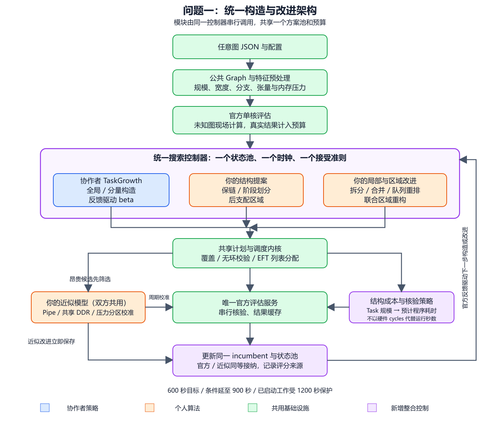
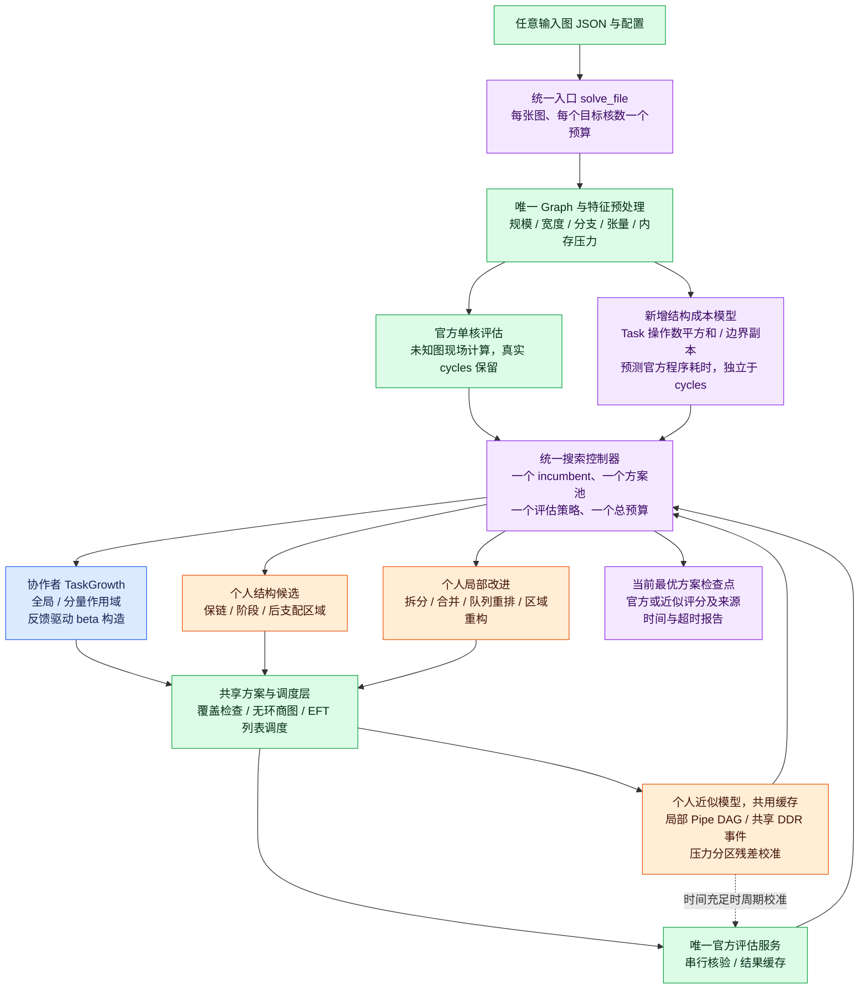

# 题目一第三版：基座专用优化模型

版本定位：第一版为协作者 TaskGrowth 基座算法（`04634a2`），第二版预留且尚未上传，本文统一版作为第三版发布。“基座专用优化”表示在基座组件之上扩展通用候选构造与搜索，不表示针对特定 case 编号优化，也不表示第二版已经实现或提交。

继承与改进的边界：图校验、COPY 收缩和依赖预处理继续复用基座使用的官方函数；公共 Graph 统一持有图结构，GraphIndex 保留基座生长特征。TaskGrowth 的划分公式与实现直接复用；核内预分析在小图上保留，大图则使用共享近似模型的局部 Task 时长。基座构造与新增结构分块在候选层并列，局部改进统一作用于两者的方案，共用调度内核、评估服务和状态池。具体调用与设计动机见下文，阅读本仓库即可理解，无需依赖对话记录。

更新日期：2026-09-26。本说明已对照当前 `adaptive` 默认实现，包含最新的“近似结果可直接接纳、官方定期校准”规则。对应既有验收运行的代码指纹：`7260a7220dcf6b356bde08e97e6c02cf4e30983f3ad8e87f7e3a1ef06f183818`；完整文件指纹见 [unified_source.json](unified_source.json)。

本次提交仅清理了 4 个源文件的末尾空行，并由 Git 按仓库约定统一为 LF；算法语义未变。Git 文件版本的代码指纹为 `067998a5a403ae9a31605c15978076a80ca85b9fa5eb9f134a3e93459a543f7f`，见清单中的 `git_export`；顶层指纹、文件哈希与旧验证记录保留为历史运行证据。代码指纹按字节计算，旧成绩不会因此自动视为新指纹下的可复用结果。提交前已运行 92 项测试，91 项通过，1 项因缺少官方附件 ZIP 跳过。

比较范围：以协作者 TaskGrowth 基础算法提交 `04634a2` 为基线，以本仓库统一版为改进实现。下文“个人策略”指整合进来的结构与局部改进策略；“新增接口”指相对该基线新增，不表示所有算法均在本次整合中首次提出。

核心思路：**TaskGrowth 提供结构化构造，结构候选与局部算子在同一个方案池中补充和改进；共用图、调度与近似模型，官方评估负责纠偏。近似改进可以直接成为最终输出。**

阅读顺序：[接口变化](#相对基础版的接口变化) → [架构](#分层结构和代码归属) → [算法流程](#当前算法如何运行) → [近似与校准](#近似模型与两类预测) → [调用](#调用) → [扩展约定](#新增接口与扩展约定) → [设计动机](#设计动机与取舍) → [验收与限制](#当前限制与验收入口)。

本实现替代 `q1-modular` 中“两套完整求解后择优”的实验架构。旧目录和旧成绩保留为历史对照，不能当作本实现的验收成绩。

## 相对基础版的接口变化

统一版在运行时直接调用仓库内保留的 TaskGrowth 实现，没有再复制一套同名生长算法。它将原来完整初始化流程中的“构造提案”接入统一搜索，而不是调用整个基础求解器后再择优。公共基础设施则从原实现中抽取、适配；策略模块保留各自需要的排序规则。

| 基础版接口或入口 | 统一版处理 | 功能与兼容性 |
|---|---|---|
| [TaskGrowth / partition](../../src/q1/partition.py) | 保留，文件相对基线未改 | 接收图索引、作用域、核数和 beta，返回 Task 划分与生长记录；由新增 Construction 直接调用 |
| [GraphIndex](../../src/q1/graph.py) | 扩展输入 | 除原始图字典外可接收公共 Graph，复用 DAG、关联和拓扑序；保留生长策略的 Tensor 视图与原始零时长语义 |
| [schedule.py](../../src/q1/schedule.py) | 抽取公共核分配内核，并提供 assign_cores | 接收图、划分方案、Task 时长和配置，返回核队列方案及分配记录；显式处理 Task 编号映射，保留基础版平局规则 |
| [initialize](../../src/q1/solver.py) | 保留为串行基座对照 | 保留 InitializationResult 的 plan、evaluation、selected、candidates、search 字段；candidate_jobs 仅接受 1，生产统一入口不调用该完整求解器 |
| [run_case / run_cases](../../src/q1/run.py) | 保留参考运行器，候选并行默认改为 1 | 服务于基础算法对照；不同 case 的批量并行与单个求解内部的串行策略分开 |
| [python -m q1](../../src/q1/__main__.py) | 默认入口切换到统一版 | 新语法为图路径加 --config / --cores / --output；旧 solve、batch 子命令移至 q1.reference_cli，不兼容直接沿用旧命令 |
| [official.py](../../src/q1/official.py)、[单核基线](../../src/common/baseline.py)、[脚本入口](../../src/solve_problem1.py) | 文件保持基础版实现 | 官方包装与单核语义保留；solve_problem1.py 通过 q1 入口间接进入统一版，文件未改不代表运行行为未变 |

对外提交的方案格式仍只有 `node_to_subgraph` 和 `core_schedules` 两个字段；评分来源、预算和搜索记录写在独立文件中。旧参考入口可用 `python -m q1.reference_cli --help` 查看，不应与统一版成绩混报。

## 分层结构和代码归属

蓝色为协作者策略，橙色为个人策略，绿色为双方共用基础设施，紫色为此次新增的统一控制层。



可编辑矢量版本见 `unified_architecture.svg`。



这里的多候选比较属于同一次启发式搜索：所有候选由同一控制器管理，其中有竞争力的方案进入有限状态池，局部改进算子可以处理协作者构造出的方案。程序没有分别运行完整基座求解器和完整个人求解器，也没有最终 `min(base_result, personal_result)` 汇合点。

| 层 | 代码 | 来源和职责 |
|---|---|---|
| 输入与图模型 | `src/q1/model.py` | 从个人图模型提取为公共模型；只解析、收缩一次 |
| 生长特征视图 | `src/q1/graph.py` | 协作者 GraphIndex，共享公共模型的 DAG、关联和拓扑序；保留生长公式所需的 Tensor 视图 |
| 生长构造 | `src/q1/partition.py` | 协作者 TaskGrowth 和划分公式 |
| 合法性与目标 | `src/q1/plan.py` | 共用覆盖、商图、队列无环校验及官方目标 |
| 调度内核 | `src/q1/allocation.py` | 共用就绪堆、前驱释放、跨核等待和队尾 EFT |
| 调度策略 | `src/q1/schedule.py`、`src/q1/improvement/schedule.py` | 分别保留双方的等价候选排序规则；共用 allocation |
| 个人算子 | `src/q1/improvement/` | 初始结构提案、拆分合并、区域重构、增量评分和校准 |
| 近似事件模型 | `src/q1/improvement/approximation.py` | 个人近似模块的升级；缓存局部 Pipe DAG，共享 DDR 带宽事件模拟，供两方候选使用 |
| 图特征与成本模型 | `src/q1/unified/features.py` | 输入预处理、方案结构复杂度、官方程序秒数预测；不读取历史多核成绩 |
| 构造接口 | `src/q1/unified/construction.py` | 每次生成一个构造候选，收到官方反馈后决定是否推进 beta |
| 搜索控制 | `src/q1/unified/engine.py` | 从个人搜索器提取，加入构造接口；维护唯一 incumbent 和状态池 |
| 评估服务 | `src/q1/unified/service.py` | 官方评估、预分析、缓存、检查点接口；单进程串行执行 |
| 运行控制 | `src/q1/unified/api.py`、`budget.py` | 任意图入口、单核计时、分级预算、超时回收、结构化结果 |

## 当前算法如何运行

### 1. 预处理原图，形成唯一的公共表示

保留原始操作、张量和边；另外建立收缩 COPY 节点后的计算操作 DAG，计算拓扑序、前驱/后继、关键路径、链与连通分量。基座的 `GraphIndex` 是这个公共模型上的视图，不重新维护一条独立求解管线。图特征在官方单核调用之前提取并写入 `features.json`。

### 2. 获得当前输入的单核参照

未知图现场运行官方单核，得到真实 cycles、实测运行秒数和初始方案。这个方案同时提供保底、初始状态和近似模型的首个校准样本。单核 cycles 是该图的真实参照，既不直接除以核数当作多核预测，也不由近似模型改写。

### 3. 构造第一批候选

协作者的 TaskGrowth 从就绪操作逐步生长 Task。试加一个操作时，它综合比较边界搬运变化、Pipe 工作量、依赖跨度、内存压力，以及“合入当前 Task”和“另开 Task”的收益。`beta=1…4` 控制工作量目标；存在独立分量时优先使用分量作用域。形成划分后由公共 EFT 列表调度分配核与队列。

结构初始算子提供保链、阶段划分、后支配区域等结构候选。对于至少 2000 个计算操作的大图，这些候选与首个 TaskGrowth 候选一起近似评分；每次发现更优近似方案，都可立即保存。首个官方核验对象另按预测成绩、压力风险和预计核验耗时选择：压力风险方案的筛选分数乘 1.35，在最优筛选分数的 2% 范围内优先选预计核验更便宜的方案。**这组风险系数只影响优先核验谁，不改写已保存的预测 cycles。**

小图先生成首个 TaskGrowth 提案，再进入个人初始候选阶段。大图构造使用共享近似模型的局部 Pipe 时长，小图保留官方预分析。两者仍使用同一套 TaskGrowth 划分公式与公共核分配内核。

### 4. 统一评分、接纳和保存

每个方案先检查操作覆盖、Task 商图与固定核队列的无环性，再调用共享近似模型。当前比较目标是按 `(makespan, added_copy_bytes)` 字典序最小化：优先减少 cycles，cycles 相同时再比较新增搬运。近似方案的搬运量是边界搬运估计，尚不含未模拟的 Spill。

近似分数低于当前最优时，直接更新最优方案和 `checkpoint.json`；不要求先经过官方核验。候选预测值在当前最优的 1.1 倍以内时，才进一步生成供改进算子使用的预测时间线并参与状态池保留。状态池最多 6 个，兼顾成绩和划分差异；较差候选仍可留下评分日志，但不会无限占用状态池。同一方案已有官方分数时，保留该已知实测分数。

### 5. 在公共状态上反复改进

局部改进算子根据当前状态的官方或预测时间线执行拆分、边界合并、队列重排、Task 迁移及多 Task 区域重构；结果重新经过公共调度与评分。`parent_plan_digest` 记录新方案从哪个公共状态产生，因此可以追溯“个人算子改进了基座构造方案”的过程。

有改进时优先继续搜索；停滞后在保留的状态之间换起点，并扩大重构区域。TaskGrowth 在首轮或连续停滞达到 3 轮倍数时补充构造候选。它的 beta 推进目前仍由收到的官方改进反馈驱动；近似与官方同等接纳，指的是公共方案池和最终保存规则，并未把所有构造内部反馈都替换为近似值。

### 6. 时间充足时用官方纠偏

预计官方调用便宜、且没有待批量核验候选时，可逐个核验；否则累积候选，并在批次或时间条件触发后尝试校准，优先核验当前近似最优。默认 600 秒预算下，便宜调用阈值为 6 秒，批次为 6 个候选；近期相对误差超过 15% 时批次缩为 3 个。

官方结果只用于当前输入的在线校准。收到结果后，替换该方案的预测分数，更新残差模型，重估池中其余近似状态，再重新选最优并写检查点。即使纠正后分数变差，也必须覆盖旧分数；官方评估失败的候选会从当前保留状态中移除。已知最好的官方方案单独保留，供重新排名时使用，它不是另一条独立算法的最终输出。

### 7. 到预算边界后输出当前最优

如果剩余时间足够，尝试对最终近似最优再作一次官方核验；不够就直接输出近似方案与来源标记。之后的离线重放只测量这一份最终方案的实际表现，不把历史答案或重放结果重新送回搜索。

## 图特征怎样影响决策

| 信息 | 当前实际用途 | 边界 |
|---|---|---|
| 计算操作数 | 以 2000 为阈值切换大图首批联合筛选及构造近似预分析 | 当前固定启发式阈值，未宣称已自动学得最优阈值 |
| 连通分量与依赖结构 | 确定基座构造作用域、候选合法性、个人区域与重构边界 | 使用当前输入，不按 case 编号分支 |
| 每个候选 Task 的局部内存压力 | 隔离残差校准样本、标记 Spill 风险、调整核验优先级 | 全图参考压力与候选局部压力不同；都不是已测 Spill 字节数 |
| Pipe 工作量、依赖跨度、边界 COPY、固定核队列 | 计算近似执行 cycles，支持调度及局部改进 | 不用单核 cycles / 核数替代这些结构信息 |
| Task 含边界副本后的操作数、总事件规模、操作数平方和 | 预测官方程序运行秒数，决定某次调用是否放得进预算 | 与执行 cycles 分开建模，预测秒数不是保证上界 |
| 图宽度、最大扇出、边密度、全图压力及标签 | 已预处理并输出，便于分析与后续扩展；底层 DAG/关键路径也供既有算子使用 | **尚未实现按这些标签自动选择一整套专用搜索策略**，不能把已采集特征都说成已参与顶层分流 |

## 近似模型与两类预测

### 执行 cycles：局部排程 + 全局共享 DDR 事件

对每个 Task 补上边界 COPY，建立局部依赖 DAG，按逆向 DFS 顺序形成各 Pipe 的串行约束，再缓存局部时长、依赖、COPY 工作量和参考内存压力。全局模拟同时处理 Task 依赖、固定核队列、同核/跨核等待，以及多个活动 COPY 对共享 DDR 的带宽竞争；DDR 剩余工作量可以是分数，避免每个事件都重新粗略取整。

这比仅取“队列时长”和“总 DDR 流量下界”的最大值更细。缓存的是可复用的 Task 局部结构；候选的全局 DDR 事件仍需模拟，不能把它描述成只计算改变区域、完全不重算全局时间线。

记事件近似为 `C_raw`，校准后预测为 `ceil(C_raw × correction)`。`correction` 来自同图最近的官方样本：根据局部压力、边界流量、工作量与并行度、Task 数等特征选择近邻，对官方/近似之比的对数作加权修正；样本相似度低时修正收缩回 1。高压力样本的残差不迁移给无压力方案，近似结果禁止反过来训练自己的校准器。

目前尚未完整模拟 Spill 插入和内存复用依赖，因此近似结果需要保留来源与压力风险。离线单核校准审计中，893 个已有方案的平均绝对相对误差为 1.11%，留出 86 张图为 1.05%，但最大误差仍约 45%；平均误差不能当作单个未知图的误差保证。审计口径见 [approximation_audit.md](approximation_audit.md)，这也不等于新版搜索已经完成全量性能验收。

### 官方程序秒数：结构复杂度 + 本次实测

令 `n_t` 为 Task 的计算操作与边界 COPY 数，`K=Σ n_t`，当前成本代理为：

```text
U(plan) = Σ(n_t²) + K × log₂(max(2, K))
```

它近似反映局部准备与事件扫描开销。首个成本预测按单核实测秒数和结构比例缩放；有多核实测后，改用本次最近样本中结构接近的样本。缓存命中不作为耗时训练样本。成本模型回答的是“这次调用可能花几秒”，近似事件模型回答的是“这个方案可能执行多少 cycles”，两者职责不同。

校准计时是**在候选处理检查点检查的协作式触发**，不是独立定时线程。较长的候选生成或官方调用会推迟下一次检查，所以约 60 秒是触发条件，不保证严格每 60 秒调用一次；预计耗时放不进剩余窗口时也会跳过。

## 预算与未知图

默认目标 600 秒，近期接纳结果有至少 0.5% 改进时允许延至 900 秒；官方与近似改进均可触发，`last_gain_source` 标记来源。已启动工作最多运行至 1200 秒保护上限。这是项目预算策略；当前按每张图、每个目标核数分别计时，不能据此认定官方已明确“5～10 分钟”为每个核数独立额度。

单核基线与首个多核候选作为入口已经启动的初始化工作，允许在保护上限内完成；单核本身超过 600 秒也不跳过所有多核尝试。近似改进立即写入检查点，时间充足再作官方校准。输入过大而触及保护上限时，保留当前检查点并报告其评分来源和超时状态。

计时从调用入口开始，涵盖输入、单核基线、建图、候选生成、官方评估和输出。每个目标核数独立求解；不读取历史多核方案，不使用 case 编号分支，不继承其他核数的历史成绩。

生产入口默认现场运行官方单核评估。其“全部操作合成一个 Task”的合法方案可作为初始保底，但单核 cycles 不能代替任意划分的多核评估。

本地测试才允许显式指定已校验的单核归档。程序校验归档清单、输入、配置、官方代码和结果 SHA-256；将归档中记录的单核耗时记入预算，并同时报告实际墙钟时间与补计后的时间。历史单核耗时来自旧环境，不能当作本次实测单核耗时。

## 调用

从仓库根目录运行，先激活已安装项目依赖的 Python 3.12 环境，并把输入图与官方配置路径替换为实际位置：

```powershell
$env:PYTHONPATH = (Resolve-Path src).Path
python -B -X utf8 -m q1 path\new_graph.json `
  --config official\data\config.txt --cores 4 --output outputs\new_graph_N4
```

接口调用同样使用总预算；Windows 调用者须有主入口保护：

```python
from q1.unified.api import solve_file

if __name__ == '__main__':
    summary = solve_file('new_graph.json', 'config.txt', 4, 'outputs/new_graph_N4')
```

`solve_file` 返回运行摘要 `summary`，最终方案写入输出目录的 `plan.json`；返回值不是方案本身。默认目标预算为 600 秒，目标核数支持 2～5，输出目录须为空。结果应连同评分来源读取，不能将预测 cycles 当作官方成绩。

入口使用一个计算子进程和一个等待中的监督父进程。监督父进程不同时运行另一套算法；子进程内图分析、候选生成、评分、官方核验全部串行。目标硬件的 2～5 核调度是模拟问题本身，与主机求解程序的并行执行是两回事。

批量本地验证脚本 `tools/benchmark_unified.py` 的 `--local-test-workers` 只允许不同 case 同时运行；同一 case 的目标核数依次运行。默认值 1。

完整 100 case 脚本为 `scripts/run_unified_100.ps1`，默认覆盖 001～100 和 2～5 核。`-LocalTestBaselineArchive` 必须显式指定才会复用单核；`-ReuseVerifiedRun` 只合并同版本且通过独立官方重放的结果。脚本先求解，再用官方程序独立重放。并发本地测试测得的秒数会受同机其他任务影响，不等同于独占机器的运行时间。

以下两段是本次本地验收的目录布局与复现记录，含仓库外相对路径；其他机器应替换为自己的输入与归档目录。现场重算单核的完整运行方式为：

```powershell
& .\scripts\run_unified_100.ps1 -Data ..\..\official\data `
  -Output outputs\full100_fresh -LocalTestWorkers 1
```

本次本地加速验收使用以下显式配置。两个多核对照参数仅供结束后的离线报告读取：

```powershell
& .\scripts\run_unified_100.ps1 -Data ..\..\official\data `
  -Output outputs\unified_features_100cases -LocalTestWorkers 16 `
  -LocalTestBaselineArchive ..\q1-modular\results\problem_1_singlecore `
  -ArchiveRepoRoot ..\q1-modular `
  -BaseSpeedups ..\..\collaborators\Zysishuiyears\q1-basic-working\outputs\q1_100cases_20260925_cpu20\submission\speedups.csv `
  -PersonalReference ..\q1-modular\outputs\refined_100cases_verified
```

当前机器为 24 核，本地测试脚本默认 16 个独立 case 并发，并优先安排输入文件较大的图。此顺序只影响本地批次排队；单图求解策略和预算不变。旧版本由 8 路切换到 16 路的记录保留在旧输出目录的 `concurrency_transition.json`；旧版本结果不能直接复用为当前版本成绩。

## 运行产物与验收口径

每个 case/核数目录包含：

- `request.json`：输入、配置和求解代码指纹，以及本次参数。
- `baseline.json`：现场计算或显式测试缓存、单核 cycles 与省略时间。
- `features.json`：单核评估之前提取的图规模、宽度、分支、分量、工作量和参考内存压力。
- `checkpoint.json`：当前最优方案和评分原子写入；可以来自官方或近似模型。
- `official_checkpoint.json`：另存已知最好的官方方案，便于校准和诊断；不会阻止更优的近似方案覆盖当前输出。
- `plan.json`、`evaluation.json`：最终方案和对应评分；近似结果含 `evaluation_source=approximate` 与预测时间线。
- `search.json`：候选动作、筛选/核验、接纳记录、阶段时间和延长原因。
- `summary.json`：本次墙钟/CPU 时间、补计时间、是否超过 600/900 秒及是否触及 1200 秒保护上限。
- `verified.json`：仅在离线独立官方重放通过后产生，可用于完整批次的验收复用。
- `official_replay.json`：离线核验最终方案得到的真实评分。它与原始近似分数分开保存，重放不回到已经结束的搜索里重新择优。

硬超时有检查点时标记 `hard_timeout_with_checkpoint`；没有方案时标记 `hard_timeout_no_solution`。`summary.json` 的 `score_source`、`speedup_source` 标明输出是官方值还是估计值。离线正式成绩比较使用重放得到的 makespan，尚无重放的近似分数单列，不混入官方成绩均值。

近似结果和官方结果都能按同一目标更新最优方案。默认每筛选一批候选（6 个，近期误差较大时缩为 3 个），或距离上次官方调用超过 `min(60秒, 目标预算×15%)`，尝试校准；前提是该候选的预计调用时间能放入剩余窗口。优先核验当前近似最优方案。结束时有余量再核验一次，无余量直接保留近似结果。

官方校准若推翻了原来的乐观评分，会替换该方案分数、更新其他近似状态的残差、重新排名并覆盖检查点；不会让失真的旧低分继续占据最优。只有官方结果可训练残差模型，同一方案已有官方分数时也不再用近似值替代已知实测值。

`tools/audit_unified.py` 在求解结束后读取历史基座和个人成绩，独立重放并生成 `comparison.csv/json`。这些历史多核成绩不传入求解器。当前性能结论必须以新目录的实测报告为准。

## 新增接口与扩展约定

以下是维护与扩展所需的主要接口，并非要求外部调用者逐层组装；一般只调用 `solve_file`。表中 plan 均遵守上述官方两字段格式，settings / params 分别表示硬件配置与搜索参数。

| 接口与代码位置 | 输入 → 输出 | 职责 |
|---|---|---|
| [Graph](../../src/q1/model.py) | 原始图 → 公共图对象 | 统一操作、张量、收缩 DAG、拓扑序与工作量；供构造、改进、调度共同使用 |
| [quotient / validate_plan / objective](../../src/q1/plan.py) | 图与划分 → 商图；图与 plan → Task 集合；评分 → 比较键 | 共用覆盖、商图及队列无环校验，统一按 makespan、added_copy_bytes 比较；结构校验不等于官方内存可行性核验 |
| [allocate](../../src/q1/allocation.py) | Task DAG、时长、核数、等待和排序策略 → 核队列、结束时间、分配记录 | 共用就绪释放与 EFT 核分配；用策略参数保留双方不同的平局选择 |
| [Construction.next / observe](../../src/q1/unified/construction.py) | 图、核数、配置、服务 → 单个候选；动作名与官方反馈 → 构造状态更新 | next 返回 (动作名, plan, 廉价代理 cycles) 或 None；observe 控制后续 beta 提案，不维护最终答案 |
| [initial_candidates / local_candidates](../../src/q1/improvement/operators.py) | 图与配置，或已有 plan、评分和参数 → 候选三元组列表 | 分别产生结构初始候选及局部拆分、合并、重排等候选；local_candidates 另返回生成数量，统一控制器决定接纳 |
| [region_partitions / rebuild_regions](../../src/q1/improvement/regions.py) | 图与区域参数，或现有 Task 与评分 → 划分候选及必要元数据 | 提供后支配区域划分与多 Task 重构，扩大单次修改范围 |
| [task_profile / simulate_plan](../../src/q1/improvement/approximation.py) | Task 或 plan、图与配置 → 局部结构或全局事件估计 | 构建局部 Pipe DAG，并模拟核队列、依赖和共享 DDR；支撑快速 cycles 预测 |
| [IncrementalEvaluator.estimate / result / observe](../../src/q1/improvement/incremental.py) | plan → 预测 cycles 与元数据、预测评分；plan 与官方评分 → 校准样本 | 复用 Task、方案缓存；生成可供算子使用的预测时间线；仅用官方样本修正误差 |
| [recognize / plan_complexity / OfficialCostModel.predict](../../src/q1/unified/features.py) | 当前图或方案结构、实测样本 → 特征或预计官方耗时秒数 | 为未知图提取特征，并为预算内的官方调用提供成本估计，不读取历史多核答案 |
| [SearchServices](../../src/q1/unified/service.py) | plan 与调用额度 → 官方结果或 None、调用记录 | 集中 evaluate、preanalyze、缓存、checkpoint、save、emit；算子不各自创建评估进程 |
| [search](../../src/q1/unified/engine.py) | 图、核数、配置、参数、预算、服务及可选种子/构造器 → plan、评分、历史 | 维护唯一最优方案与有限状态池，统一处理接纳、校准、停滞切换和最终选择 |
| [solve_file](../../src/q1/unified/api.py)、[SearchBudget / run_bounded](../../src/q1/unified/budget.py) | 输入/配置路径、核数、输出目录和预算 → 摘要与落盘结果 | 组织基线与搜索，实施分级预算、监督进程和超时恢复；保留评分来源与耗时证据 |

扩展约束：

- 新算子接收公共 Graph 与方案，返回候选；经共享调度、校验和评分后由控制器接纳。接受的局部候选记录 `parent_plan_digest`，可追溯其改进的公共状态。
- 不自行保存另一份最终答案、不向求解器注入历史多核方案或离线成绩。官方附件代码保持原样；`improvement/graph.py`、`shared.py` 等薄适配模块仍有导入依赖，不能仅因文件短而删除。
- 算子应读取 `evaluation_source`，不能假定输入时间线一定来自官方；预测结果中未模拟的 Spill 字节数为 `None`，不是实测零。
- `official_per_round=4` 是沿用的配置名，目前限制的是每轮候选尝试数，不保证执行 4 次官方评估。

## 设计动机与取舍

| 要解决的问题 | 设计选择 | 收益与代价 |
|---|---|---|
| 两套完整求解器各自建图、核验，再取最小值，重复开销大且无法交换中间状态 | TaskGrowth 改为逐个提案，结构算子在公共方案池中继续改进 | 基础构造可直接成为局部搜索起点；候选顺序已改变，不能继承旧架构的“不劣于两者”保证 |
| 双方独立维护图与调度代码，语义容易漂移 | 公共 Graph、合法性检查和 allocation 内核；策略层保留排序差异 | 减少重复解析和规则分歧，同时保留可解释的策略差别；共享层变更须兼顾两方调用 |
| 高核数下粗粒度 Task 可能限制并行度，单点修改容易停滞 | 结合拆分、合并、迁移、多 Task 区域重构与多状态起点 | 能跨越需要协调修改的局部极小值；更多 Task 也会增加 COPY、等待与内存成本，因此不以 Task 数越多越好为目标 |
| 独立分量天然存在可并行空间，但全局构造可能未优先利用 | 有独立分量时优先分量构造，随后仍允许全局候选 | 按当前图结构安排搜索机会，不为某个 case 特判；分量候选仍需评分，不能保证一定更优 |
| 每轮重新构造挤占局部改进时间 | 首轮及停滞后补充构造，保留有限状态池，最大探索轮数提高到 64 | 在同一预算内兼顾新起点与深入改进；轮数上限不是每次都能完成的承诺 |
| 完整官方模拟昂贵，会消耗本可用于搜索的时间 | 缓存局部结构与已评方案，近似接纳，按成本安排批量官方校准 | 提高可探索候选数；新增候选仍需全局近似事件模拟，且近似可能误排、遗漏内存风险 |
| 单一误差倍率不能覆盖带宽竞争和压力变化 | 显式共享 DDR 事件，按同图相近结构与压力分区校准 | 比简单时长求和更能反映相互影响；Spill 与内存复用依赖仍是误差来源，均值低不代表极端误差低 |
| 未知图的评估成本差异大，固定调用次数或预留时间浪费预算 | 用结构复杂度和本次实测预测官方秒数，与 cycles 预测分开 | 便宜调用可多做，昂贵调用择机做；耗时预测不是硬上界，也不等于使用预先已知的 case 成绩 |
| 搜索触墙可能丢失已完成工作，成绩又必须可复核 | 分级预算、原子检查点、独立官方检查点及搜索结束后的官方重放 | 保存可恢复方案和来源，真实成绩可独立验证；主输出可以是未核验近似方案，初始化未完成仍可能没有解 |

## 当前限制与验收入口

这份说明描述实现与设计依据，不宣称统一版已在所有图上优于基础版。共享算子的等价性、最终搜索成绩及近似误差是三种不同的验收问题：

- **接口与共享语义：**现有回归测试位于 [tests](../../tests)，从仓库根目录设置 `PYTHONPATH=src` 后运行 `python -B -m unittest discover -s tests`。重点检查 Task 编号、拓扑、调度平局、结构合法性及预算/来源记录；文档修改本身不代表这些测试已重新执行。
- **最终成绩：**用 [benchmark_unified.py](../../tools/benchmark_unified.py) 求解，再由 [audit_unified.py](../../tools/audit_unified.py) 独立官方重放并比较。逐例报告退化、超时与无解，区分求解时间和离线重放时间，不能仅报告平均提速。
- **近似误差：**口径见 [approximation_audit.md](approximation_audit.md)。既有方案上的误差审计不等于新版搜索产生方案的全量性能验收；旧版记录见 [paused_scores.md](paused_scores.md)。

当前还有以下实现边界，评审和后续修改时应明确：

1. `SearchServices.evaluate(plan, timeout)` 的 timeout 用于记录和协作式预算决策，不会单独中断这一次官方调用；最终强制保护由监督父进程执行。因此官方调用成本估计偏低时，仍可能触及 1200 秒上限。
2. 当前最优检查点允许近似评分。它通过结构校验，不代表已通过官方局部内存可行性检查；单核初始化尚未完成时，也不能保证保护上限前一定已有可恢复解。
3. [incremental.py](../../src/q1/improvement/incremental.py) 读取单核搬运基数的键为 `original_copy_bytes`，而官方结果使用 `original_graph_copy_bytes`，目前存在字段不一致。它影响近似 `added_copy_bytes` 与官方次级目标的可比性，尤其是 makespan 相同时；不能把近似搬运量描述为与官方完全等价。本次文档补充未修复此代码问题。
4. [configs/unified.json](../../configs/unified.json) 的描述仍含“官方裁决”旧措辞；当前实际行为是近似可接纳、官方周期纠偏，以代码及本说明的来源规则为准。
